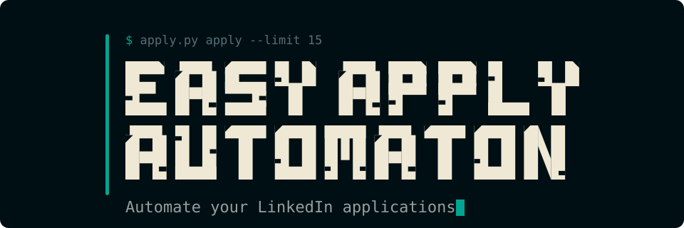
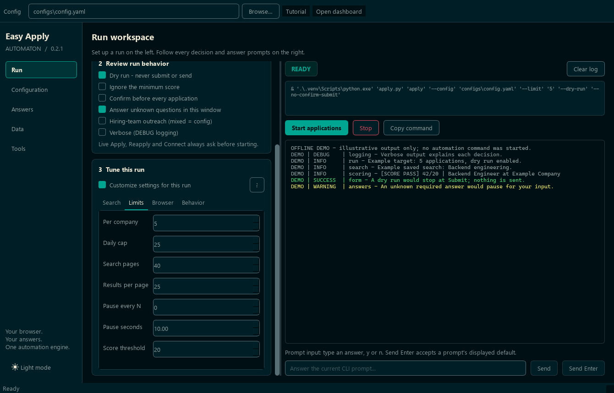
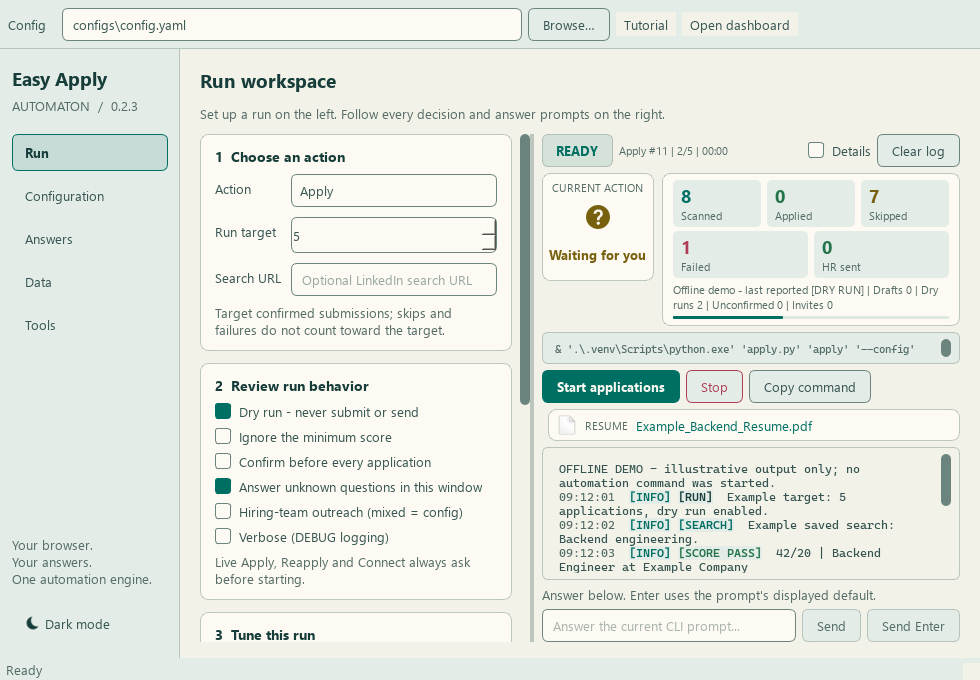

<p align="center">
  
</p>
<p align="center">
  <a href="https://github.com/Zanark/LinkedIn-EasyApply-Automaton/releases/tag/v0.2.4">Download for Windows</a> &nbsp; · &nbsp;
  <a href="docs/setup-and-commands.md">Setup &amp; commands</a> &nbsp; · &nbsp;
  <a href="docs/gui-tutorial.md">Tutorial</a>
</p>

<div align="center">

**Find jobs, score them, fill Easy Apply from your own answers, and track the results.
Desktop app or CLI — same engine.**


<sub>18-second offline walkthrough of current source: larger icons in the same box, rounded action labels and state-colored glow, changing resume selections and live counters, using fictional data. No command runs or application is submitted.
<a href="docs/images/gui-run-walkthrough.gif">Open the GIF</a>.</sub>

</div>

> **Account risk:** LinkedIn prohibits automation and may restrict your account.
> Educational use only; not affiliated with LinkedIn. Use at your own risk.
> Sign-in is manual; this app does not store your password.

## Get started

**Windows:** [Download v0.2.4](https://github.com/Zanark/LinkedIn-EasyApply-Automaton/releases/tag/v0.2.4),
extract the **entire ZIP**, then open `EasyApplyAutomaton.exe`.
Keep `lea.exe` and `_internal` beside it. No Python installation needed; installed
Edge/Chrome is required. Browser binaries are not bundled, and the EXEs are unsigned.

First launch creates example files in `%LOCALAPPDATA%\EasyApplyAutomaton`.
Add your config, answers and resume PDFs, then use **Tools → Sign in**.
Start with **Scan**, then **dry-run Apply**, before enabling live actions.
[Full executable setup](docs/gui.md#windows-executable).

**Already configured?** [Reuse your existing workspace](docs/gui.md#reuse-an-existing-setup)
instead of initializing again. Set `LEA_WORKSPACE` when launching the EXE against
that setup. Private config snapshots belong in ignored `private-setup`, never a release.

<details>
<summary>Install from source</summary>

For a new source installation:

```powershell
python -m venv .venv
.\.venv\Scripts\python.exe -m pip install -e ".[gui,dashboard]"
.\.venv\Scripts\python.exe apply.py init
.\.venv\Scripts\python.exe apply.py gui
```

Edit the example config/answers and sign in manually through Tools before running.
[Every command and option](docs/setup-and-commands.md).

</details>

**Optional:** Streamlit [dashboard](INIT.MD#dashboard) (auto-sized tables, clear answer approval,
overdue outreach queues, clickable skip reasons and report downloads)
and AI need source extras; they are not in the
Windows ZIP. Dynamic resumes need the separate
[resume builder](https://github.com/Zanark/dynamic-resume-builder) and its external Python.

**Source Connect repair:** the optional no-note fallback now waits for usable controls
and recognizes final Send/Connect only inside an identified invitation dialog.
Notes stay preferred; dry-run never sends. [Behavior and safeguards](docs/configuration.md#outreach).
The v0.2.4 download is unchanged.

## Screenshots



<sub><b>Tune each run:</b> limits and pauses without editing YAML; hover a field for its purpose and example.</sub>



<sub><b>Light theme, smaller window:</b> larger action icon, rounded centered name and color-matched border glow, last-selected resume, counters and color-coded logs.
Both themes come from <a href="https://github.com/Zanark/DeepSeaFoam">DeepSeaFoam</a>.
Current source uses 64px icons inside the unchanged 112×108px box; the v0.2.4 download is unchanged. Previews use fictional offline data.</sub>

## Action icon glossary

The action tile shows **what the command is doing**, not whether it succeeded.
Its border/glow follows the action's color: **blue** for routine work, **teal**
for content/selection/saving, **green** for command completion, **yellow** for
pauses/skips/warnings, and **red** for errors/discarding.

<details>
<summary>Show all 36 icons and their meanings</summary>

The actual GUI artwork is shown in Harbor Daylight colors. DeepSeaFoam uses
the same designs with its own palette. The
[detailed glossary](docs/gui-action-icons.md) also lists each state ID and color.

| Icon | Action | Meaning |
| --- | --- | --- |
|  | **Ready** | The window is ready to start a command. |
|  | **Starting command** | Launching the selected command's child process. |
|  | **Running command** | The child process is running; no more-specific stage is displayed yet. |
|  | **Command finished** | The command exited successfully, not necessarily every application. |
|  | **Stopped** | The command was stopped through the GUI. |
|  | **Command error** | The command could not start or exited with an error. |
|  | **Status unavailable** | Status updates could not be read reliably; check the console. |
|  | **Opening browser** | Opening the configured automation browser and profile. |
|  | **Searching jobs** | Reading job-search results for the current search. |
|  | **Opening job** | Opening a job posting's details. |
|  | **Checking job** | Recording, filtering and scoring the job before an application. |
|  | **Skipping job** | Recording why this job will not receive a live application in this pass. |
|  | **Selecting resume** | Choosing a mapped or fallback resume for the job. |
|  | **Resume review pause** | Taking the configured timed pause after the resume choice. |
|  | **AI job review** | Asking the optional AI advisor to evaluate the job. |
|  | **Building resume** | Requesting a per-job tailored resume from the optional builder. |
|  | **Preparing application** | Registering the final resume choice and preparing the application record. |
|  | **Writing cover letter** | Preparing cover-letter content for this application. |
|  | **Opening application** | Opening the posting's Easy Apply dialog. |
|  | **Filling application** | Detecting questions and filling the current form step. |
|  | **Selecting attachment** | Looking for or selecting the matching resume in the page's attachment picker. |
|  | **Uploading document** | Attempting to upload a resume or cover-letter file. |
|  | **Reviewing application** | Advancing the form to its review step; this is not a manual approval pause. |
|  | **Waiting for you** | Waiting for an answer, approval or requested manual attachment. |
|  | **Submitting application** | Attempting the Submit action; success is not confirmed yet. |
|  | **Checking submission** | Checking the page for submission confirmation or another outcome. |
|  | **Discarding application** | Attempting to dismiss and discard an unfinished application. |
|  | **Finding hiring team** | Reading the job's Meet the hiring team contacts. |
|  | **Drafting outreach** | Preparing a hiring-team message and connection note. |
|  | **Sending outreach** | Attempting to send an approved hiring-team message. |
|  | **Loading invitations** | Loading and deduplicating saved pending connection targets, not incoming requests. |
|  | **Processing invitation** | Checking a target profile and processing its invitation, or previewing a dry run. |
|  | **Saving results** | Saving an application outcome or run summary to the database. |
|  | **Writing report** | Producing the run's outreach report. |
|  | **Pacing pause** | Waiting for a configured pacing delay. |
|  | **Finishing run** | Performing end-of-run work and cleanup; further outreach stages may still follow. |

Stages depend on the command and enabled options; they can repeat or be skipped.
**Waiting for you** needs your response; **Resume review pause** and **Pacing pause**
are timed waits. Use the console and confirmed-outcome counters to check results.

</details>

## Documentation

| Need | Guides |
| --- | --- |
| Use the app | [Desktop GUI](docs/gui.md) · [21-topic tutorial](docs/gui-tutorial.md) · [Action icon glossary](docs/gui-action-icons.md) · [Run guide](INIT.MD) |
| Configure | [Configuration](docs/configuration.md) · [Resume generation](generated/resume/README.md) · [FAQ](docs/faq.md) · [Troubleshooting](docs/troubleshooting.md) |
| Learn the code | [Architecture](docs/architecture.md) · [Run lifecycle](docs/run-lifecycle.md) · [Data structures](docs/data-structures.md) · [Algorithms](docs/algorithms.md) · [Builder integration](docs/resume-studio.md) |
| Contribute | [Developer guide](docs/developer_guide.md) · [GitHub tracking](docs/github-tracking.md) · [Public project handoff](.agent-context/public/README.md) |
