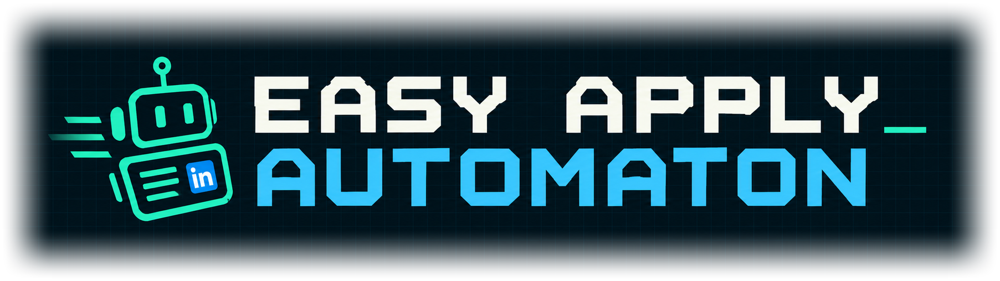
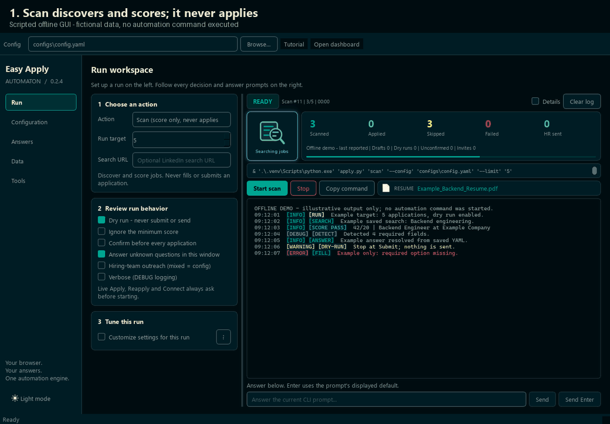
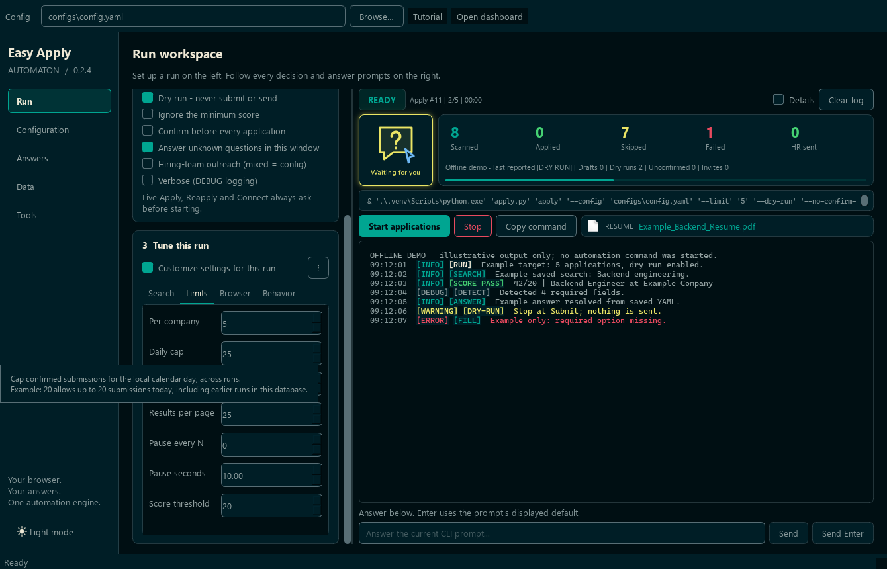

  

  <a href="https://github.com/Zanark/LinkedIn-EasyApply-Automaton/releases/tag/v0.2.4">Download for Windows</a> &nbsp; · &nbsp;
  <a href="docs/getting-started/setup-and-commands.md">Setup &amp; commands</a> &nbsp; · &nbsp;
  <a href="docs/guides/gui-tutorial.md">Tutorial</a>

**Find jobs, score them, fill Easy Apply from your own answers, and track results.**

Current source, fictional data: Scan, dry-run Apply, retry preview and Connect.
No browser or sends. <a href="docs/assets/images/gui-run-walkthrough.gif">Open the walkthrough</a>.

> **Account risk:** LinkedIn prohibits automation and may restrict your account.
> Educational use only; not affiliated with LinkedIn. Use at your own risk.
> Sign-in is manual; this app does not store your password.

## Get started

**Windows:** [Download v0.2.4](https://github.com/Zanark/LinkedIn-EasyApply-Automaton/releases/tag/v0.2.4),
extract the **entire ZIP**, then open `EasyApplyAutomaton.exe`.
No Python needed; use installed Edge/Chrome. [Full setup](docs/guides/gui.md#windows-executable).

**First run:** add your config, answers and resume PDFs; use **Tools → Sign in**.
Start with **Scan**, then **dry-run Apply** before enabling live actions.

**Source / CLI:** [Install and commands](docs/getting-started/setup-and-commands.md).
**Already configured?** [Reuse your workspace](docs/guides/gui.md#reuse-an-existing-setup); do not initialize again.

Previews show current source, including larger icons and the five-card retry
preview. The **v0.2.4 download is unchanged**.

## Screenshots

<b>Tune each run:</b> limits and pauses, with purpose-and-example hover help.

<b>Compact light theme:</b> action, retained resume, counters and colored logs.
Fictional data; themes from <a href="https://github.com/Zanark/DeepSeaFoam">DeepSeaFoam</a>.

## Action icon glossary

[All 36 icons and their meanings](docs/guides/gui-action-icons.md), including the
color/glow legend. Stages describe operations, **not confirmed outcomes**.

View the complete icon set

| Action | Action | Action | Action |
| --- | --- | --- | --- |
|  Ready |  Starting command |  Running command |  Command finished |
|  Stopped |  Command error |  Status unavailable |  Opening browser |
|  Searching jobs |  Opening job |  Checking job |  Skipping job |
|  Selecting resume |  Resume review pause |  AI job review |  Building resume |
|  Preparing application |  Writing cover letter |  Opening application |  Filling application |
|  Selecting attachment |  Uploading document |  Reviewing application |  Waiting for you |
|  Submitting application |  Checking submission |  Discarding application |  Finding hiring team |
|  Drafting outreach |  Sending outreach |  Loading invitations |  Processing invitation |
|  Saving results |  Writing report |  Pacing pause |  Finishing run |

## Documentation

[Browse all guides](docs/README.md) · [Repository layout](docs/development/repository-layout.md)

| Need | Guides |
| --- | --- |
| Use the app | [Desktop GUI](docs/guides/gui.md) · [21-topic tutorial](docs/guides/gui-tutorial.md) · [Action icon glossary](docs/guides/gui-action-icons.md) · [Run guide](docs/getting-started/run-guide.md) |
| Configure | [Configuration](docs/guides/configuration.md) · [Resume generation](generated/resume/README.md) · [FAQ](docs/guides/faq.md) · [Troubleshooting](docs/guides/troubleshooting.md) |
| Learn the code | [Architecture](docs/architecture/overview.md) · [Run lifecycle](docs/architecture/run-lifecycle.md) · [Data structures](docs/architecture/data-structures.md) · [Algorithms](docs/architecture/algorithms.md) · [Builder integration](docs/guides/resume-studio.md) |
| Contribute | [Developer guide](docs/development/developer_guide.md) · [GitHub tracking](docs/development/github-tracking.md) · [Public project handoff](.agent-context/public/README.md) |
