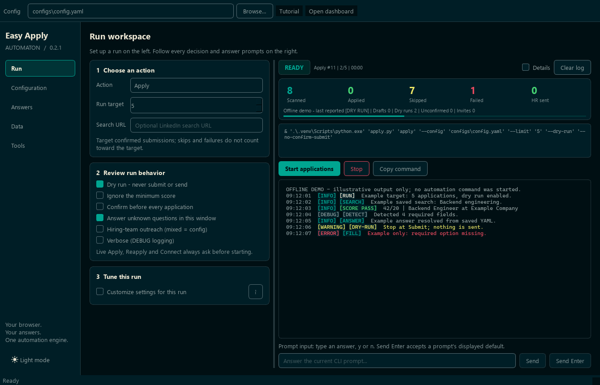
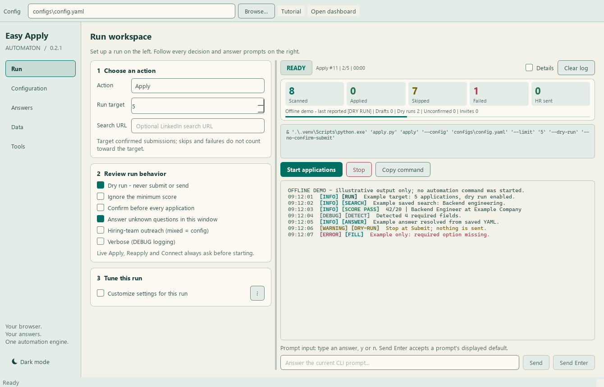
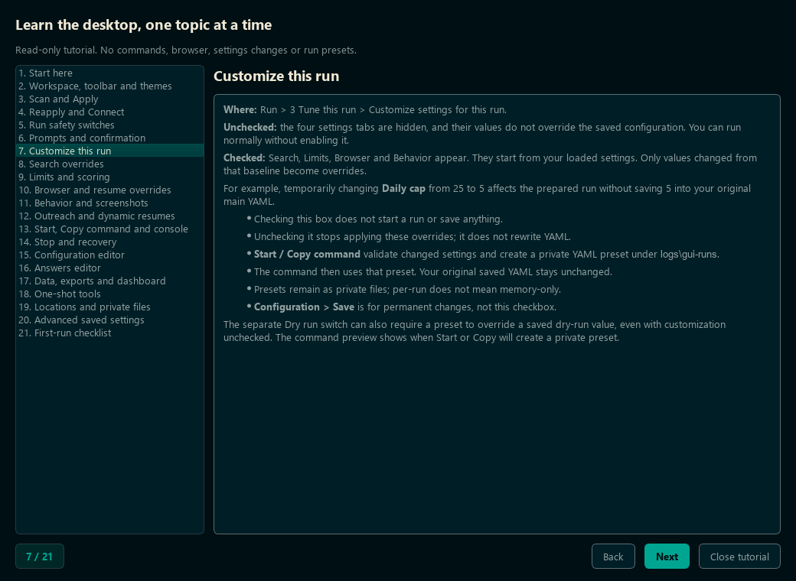
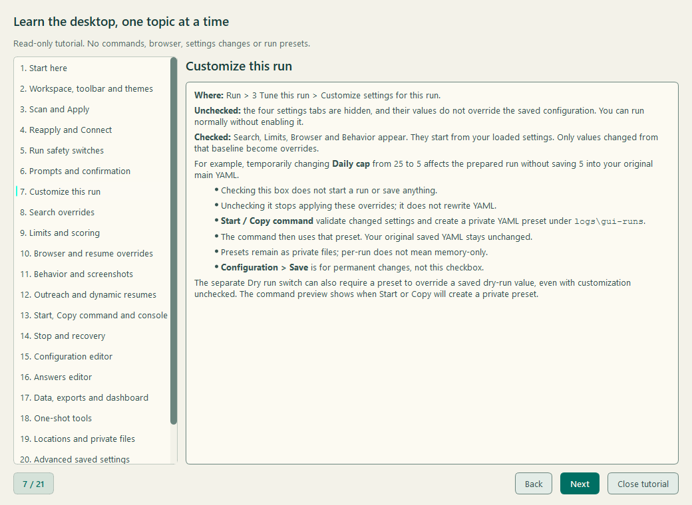
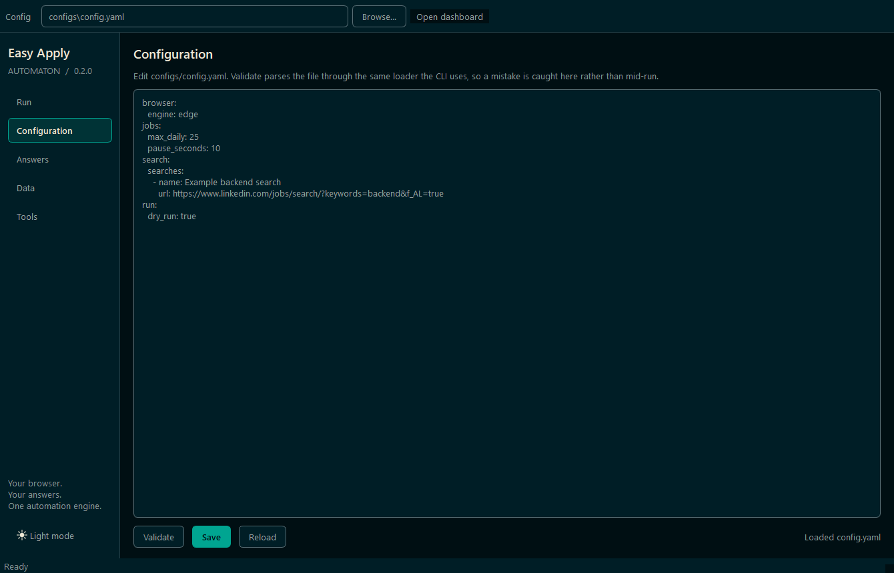
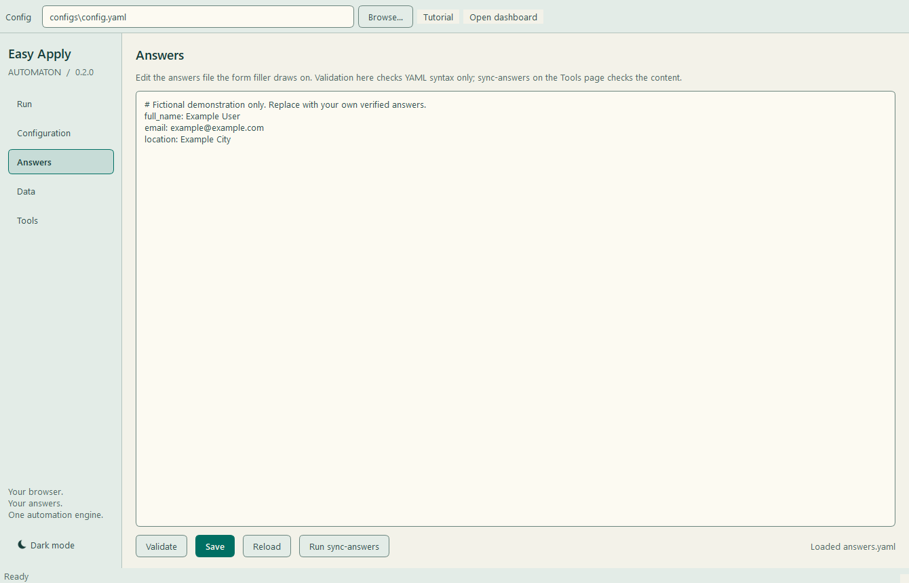
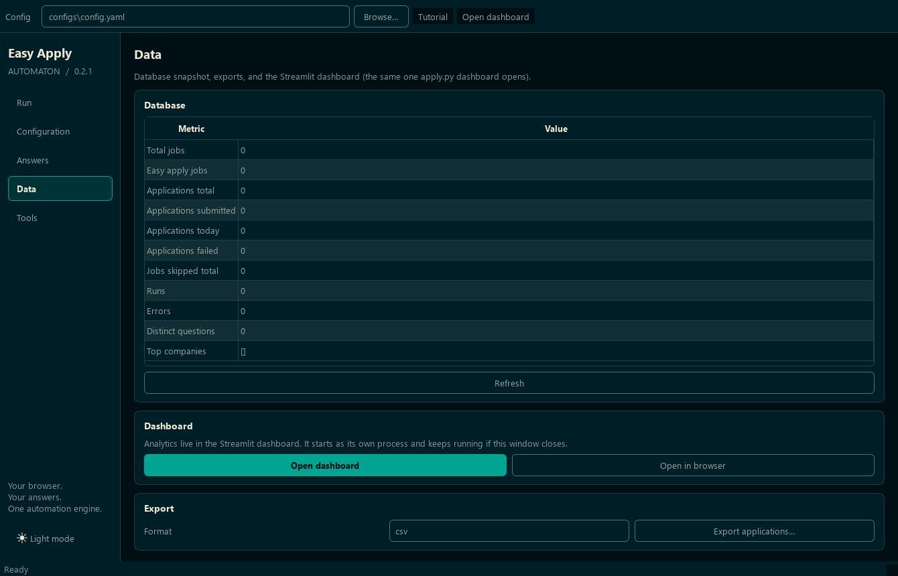
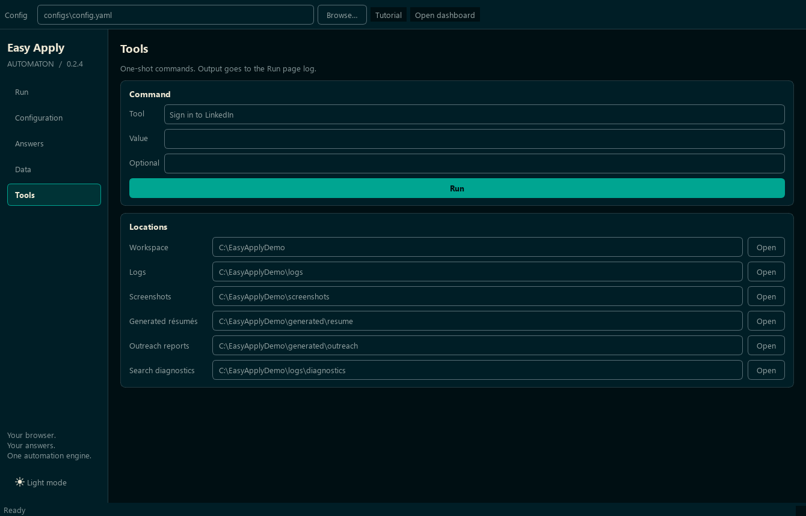
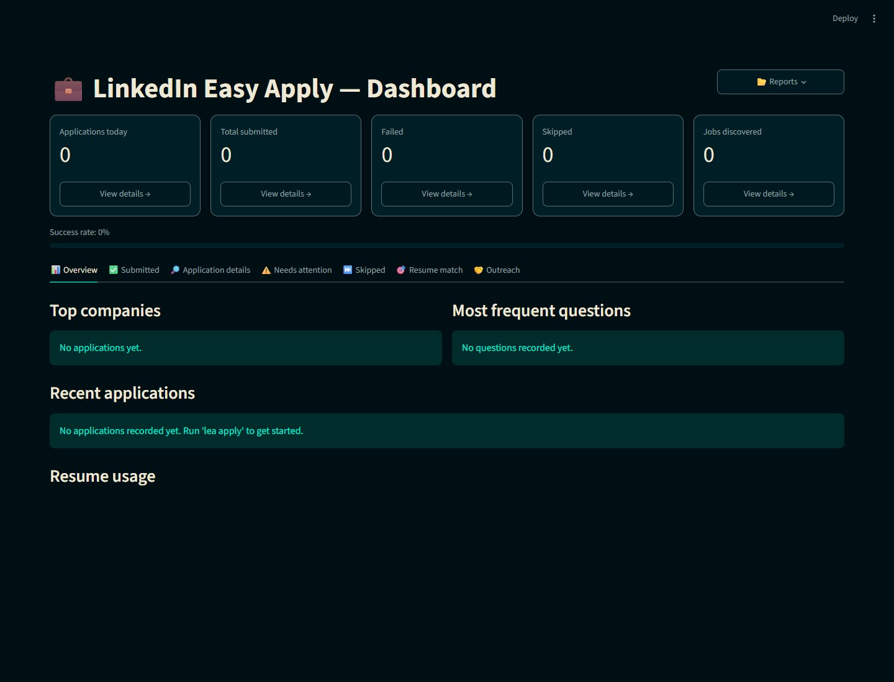

<p align="center">
  
</p>
<p align="center">
  
</p>
<p align="center">
  <a href="docs/setup-and-commands.md">Setup &amp; commands</a> &nbsp; · &nbsp;
  <a href="docs/gui.md">Desktop GUI</a> &nbsp; · &nbsp;
  <a href="docs/gui-tutorial.md">Guided tutorial</a> &nbsp; · &nbsp;
  <a href="docs/configuration.md">Configuration</a> &nbsp; · &nbsp;
  <a href="INIT.MD">Run guide</a> &nbsp; · &nbsp;
  <a href="docs/troubleshooting.md">Troubleshooting</a>
</p>

<div align="center">

**Discovers jobs from your searches, scores them against your criteria, picks the right résumé,
answers every question from your own answer file, and applies — in a window or from the terminal.**



<sub>Source-generated preview of the v0.2.1 desktop: run controls, private overrides, tutorial access, wrapped logs and prompt input. All desktop screenshots use isolated fictional data, not live applications.</sub>

</div>

> ⚠️ **Read this first.** Automating LinkedIn violates their Terms of Service and can get your account
> restricted. This project is provided for educational purposes; **use it at your own risk.** It never
> stores your password — you stay logged in through your own browser profile.

---

## Two front ends, one engine

The desktop app is a **front end for the CLI**, not a second implementation. Every button builds
the same command, prints it to the log, and runs it: `apply.py` from source or `lea.exe` when packaged.

**Windows, no Python install:** get the ZIP from
[the latest release](https://github.com/Zanark/LinkedIn-EasyApply-Automaton/releases/latest),
extract the **entire folder**, and open `EasyApplyAutomaton.exe`. Keep `lea.exe` and `_internal`
beside it. Use installed Edge/Chrome; browser binaries are not included. First launch creates
private example configs in `%LOCALAPPDATA%\EasyApplyAutomaton`, separate from any source checkout.
See [the executable setup and limitations](docs/gui.md#windows-executable).

The [v0.2.1 Windows package](https://github.com/Zanark/LinkedIn-EasyApply-Automaton/releases/tag/v0.2.1)
includes the full 21-topic offline tutorial: **109.2 MiB ZIP** (114,514,070 bytes),
**255.0 MiB extracted** (267,411,166 bytes; 450 files). The downloaded package's
checksums and every installed file were verified against the release's build
manifest and `SHA256SUMS`. Offline GUI/CLI and native tutorial startup were
checked separately; this is not fresh-machine, live-site or human visual qualification.
The executables are unsigned; Windows may show a SmartScreen warning.
Configure your answers and sign in manually before your first run.

**Already have a working source setup?** Run the GUI from that checkout to keep
your existing configuration, answers, resumes, history and browser profile.
No new setup or initialization is needed. See
[reuse an existing setup](docs/gui.md#reuse-an-existing-setup) for source and EXE launch instructions.
Machine-local input snapshots belong in the ignored `private-setup` folder,
not in the release or a public upload.

```powershell
.\.venv\Scripts\python.exe apply.py gui            # drive it from a window
.\.venv\Scripts\python.exe apply.py gui --tutorial # read the offline guide without private setup
.\.venv\Scripts\python.exe apply.py apply -n 15    # drive it from the terminal
```

---

## Two themes

Dark **DeepSeaFoam** and light **Harbor Daylight**, switchable from the sidebar and remembered
between launches.

| Role | DeepSeaFoam (dark) | Harbor Daylight (light) |
| --- | --- | --- |
| Ambient field | `#000F13` | `#F3F2E9` |
| Panels | `#001E26` | `#E3ECE7` |
| Reading ink | `#93A1A1` | `#355451` |
| Headings | `#EEE8D5` | `#173D3A` |
| Accent | `#00A591` | `#006F63` |
| Status | `#45D072` · `#EBE565` · `#E84A5F` | `#247449` · `#77600E` · `#AD3E55` |

| DeepSeaFoam | Harbor Daylight |
| --- | --- |
|  |  |

Both palettes come from the [DeepSeaFoam](https://github.com/Zanark/DeepSeaFoam) design project.

---

## What you can do in the window

### Guided tutorial — every control, without starting a run

Use **Tutorial / F1**, or the **?** beside **Customize settings for this run**.
Back/Next and a topic list cover the five pages, all run settings, prompts,
private presets and real-action boundaries. The guide does not change controls
or files, and is blocked while a command runs so it cannot hide a live prompt.
`gui --tutorial` opens only the guide, without loading configuration/history.
Read [the same guide as Markdown](docs/gui-tutorial.md).

From the extracted **v0.2.1** folder, open just the guide without initializing
configuration, history or a browser:

```powershell
.\EasyApplyAutomaton.exe --tutorial
# Or use the companion CLI:
.\lea.exe gui --tutorial
```

| DeepSeaFoam | Harbor Daylight |
| --- | --- |
|  |  |

<sub>Contextual checkbox explanation and replayable navigation in both themes, captured from source with fictional isolated state. The same guide is bundled in v0.2.1; older v0.2.0 EXEs do not contain it.</sub>

### Run — scan, apply, reapply, connect

Pick an action and target, then tune saved searches/exact job URLs, limits, browser, resume and
behavior settings without editing the saved YAML. **Start** and **Copy command** create a validated,
private preset when needed. The wrapped console shows live prompts; answer them in the input row,
or enable approval before each submission. Live Apply, Reapply and Connect ask before starting.

**Stop** forcibly terminates the child and may leave browser processes or unfinished cleanup;
it is not graceful Ctrl+C. **Copy command** copies the exact PowerShell equivalent.

For a bounded CLI batch, configure `search.job_urls` with exact LinkedIn job URLs.
`apply` processes that list instead of crawling, preserving normal checks and limits;
use `--dry-run` to rehearse it first.


<sub>Expanded run settings: company/daily caps, search pages, page size, pauses and score threshold. Search, Browser and Behavior have their own tabs; overrides leave saved YAML unchanged.</sub>

<details>
<summary>Smaller window in Harbor Daylight</summary>


<sub>At 980 × 680, setup scrolls independently while the wrapped console and prompt input remain accessible.</sub>

</details>

### Configuration — edit and validate before you run

Validate parses your YAML **and** runs it through the same config model the CLI loads, so a bad value
is caught here instead of halfway through a crawl. Save refuses to write a file that does not validate.



<sub>The saved configuration editor validates through the CLI's own configuration model.</sub>

### Answers — the file that fills the forms

The same editor for `answers.yaml`, whose path is read from your config. **Run sync-answers** grades
every recorded answer against your résumé and reports the drift.



<sub>Harbor Daylight answers editor, using fictional example values only.</sub>

### Data — statistics, export, dashboard

A live snapshot of the database, CSV/XLSX export, and the dashboard launcher.



<sub>Local statistics and CSV/XLSX export. The dashboard launcher is source-install only.</sub>

### Tools — sign in, verify, inspect

One-shot commands plus every runtime folder — logs, screenshots, generated résumés, outreach reports,
search diagnostics — one click from Explorer.



<sub>One-shot tools and explicit workspace paths, separate from run setup.</sub>

---

## The analytics dashboard

A separate read-only Streamlit surface in the source installation, opened from the GUI's Data
page or `apply.py dashboard`. It is not included in the portable Windows download.
Clickable KPI cards drill into any category; seven tabs cover submitted applications (expand any one
to replay what was asked, what was answered and which résumé went out), the questions that blocked an
application, **why** every skipped job was skipped, how well your answers match your résumé, and
drafted hiring-team outreach.

The dashboard defaults to **DeepSeaFoam**: deep teal surfaces, seafoam controls and charts,
warm headings, and distinct success/warning/error colors. Launch from the repository root;
restart an already-running dashboard once to load the new native theme.



<sub>DeepSeaFoam on a fresh, empty preview database — the zeros are real, not a redaction.</sub>

---

## How it works

```
discover → extract → dedupe → filter → score → select résumé
        → (AI advise) → Easy Apply workflow → persist → learn answers
```

The `Orchestrator` coordinates focused modules (`config`, `parser`, `scoring`, `answers`, `forms`,
`browser`, `jobs`, `ai`, `database`). Playwright is imported lazily, so the pure-logic modules run
and unit-test without a browser.

---

## Highlights

- **Your browser, your session.** A Playwright persistent context reuses a profile you signed into by
  hand. No credentials, no automated login, no password ever stored.
- **Questions answered dynamically.** A hybrid keyword + fuzzy parser maps free-form Easy Apply
  questions onto your answer file. Unknown questions pause for input and are **remembered**; a
  `custom_questions` map pre-answers bespoke screening questions for unattended runs.
  Missing skill-specific experience is never replaced with total career years; hybrid and
  commuting questions require their own approved answers, not a remote preference or city.
- **Weighted scoring you control.** Whole-word matching (so `go` ≠ `google`) and punctuation keywords
  (`c++`, `.net`), negative weights as vetoes, and an explainable per-job breakdown stored in the
  database. Set `scoring.enforce: false` or pass `--ignore-score` to keep the score as a signal
  without letting it skip anything.
- **Résumés that fit the job.** Picks the best PDF from `generated/resume/`, checks LinkedIn's
  existing filename-labelled resume radios/cards first, and verifies the selection after any picker rebuild. Uploads once
  only if the active resume step has no matching document. Opt into per-job **dynamic résumés** and the
  standalone [dynamic-resume-builder](https://github.com/Zanark/dynamic-resume-builder) re-emphasises
  your `master.yaml` for each posting — it never fabricates.
- **Safety rails.** Per-run, per-company and daily caps; blacklist/whitelist; include/exclude
  keywords; URL and company-role dedupe; LinkedIn's own daily cap detected and respected; graceful
  Ctrl+C. A submission counts only after visible LinkedIn confirmation. An uncertain Submit
  is recorded as `unconfirmed`, stops the run, and is excluded from automatic retries.
- **Hiring-team outreach.** After a successful application, read each recruiter's name and profile
  URL, draft a full message **and** a ≤300-char connection note, and write a report for you to send
  by hand. Never clicks anything unless you opt into `mode: send`.
- **It tells you what it is thinking.** `-v` narrates every field: what was parsed, which answer
  resolved and *from where*, filled or skipped. When discovery finds nothing it reports why — page
  title, per-selector match counts, and a screenshot + HTML dump in `logs/diagnostics/`.
- **Everything persisted.** SQLite for jobs, applications, questions, scores, skips and errors, with
  learned-answer reuse, `stats`, and CSV/XLSX export.
- **Optional AI advisor** that only *advises* — it can never submit.
- Clean, typed, tested codebase (ruff + black + mypy + pytest).

---

## Quick start from source

```powershell
python -m venv .venv
.\.venv\Scripts\python.exe -m pip install -e ".[gui,dashboard]"

.\.venv\Scripts\python.exe apply.py init          # scaffold configs
.\.venv\Scripts\python.exe apply.py login         # sign in once, by hand
.\.venv\Scripts\python.exe apply.py scan          # discover + score, never applies
.\.venv\Scripts\python.exe apply.py gui           # or drive it from the window
```

📖 **Full setup, every command and every option: [docs/setup-and-commands.md](docs/setup-and-commands.md)**

---

## Documentation

| Guide | What's in it |
| --- | --- |
| **[Setup & Commands](docs/setup-and-commands.md)** | Install, extras, first run, and the complete command/option reference. |
| [Run Guide (INIT.MD)](INIT.MD) | Narrative walkthrough with copy-paste examples. |
| [Desktop GUI](docs/gui.md) | The window, its five pages, the themes, and how it maps onto the CLI. |
| [Configuration](docs/configuration.md) | Every file and key explained. |
| [Contributor tracking](docs/github-tracking.md) | Numbered workstreams, GitHub Project, safe preview/apply and recovery. |
| [Troubleshooting](docs/troubleshooting.md) | Fixes for common problems. |
| [FAQ](docs/faq.md) | Safety, AI, résumés, data storage. |
| [Résumé generation](generated/resume/README.md) | How the automaton gets the PDF it submits. |

### Learning the internals

Deep dives that teach the computer science behind this codebase and map it to patterns used at scale:

- [Run Lifecycle](docs/run-lifecycle.md) — one run, stage by stage, with the log lines you'll see.
- [Architecture & Design Patterns](docs/architecture.md) — diagrams, Functional-Core/Imperative-Shell,
  and every pattern used here with real code.
- [Data Structures](docs/data-structures.md) — the maps, sets, enums, DTOs and schema, with complexity.
- [Algorithms](docs/algorithms.md) — normalization, fuzzy matching, weighted scoring, backoff.
- [Résumé generation](docs/resume-studio.md) — why the builder is a standalone tool.

---

## Disclaimer

This software is not affiliated with, endorsed by, or connected to LinkedIn. Automating the platform
may violate LinkedIn's User Agreement and could lead to account restrictions. You are solely
responsible for how you use it.
