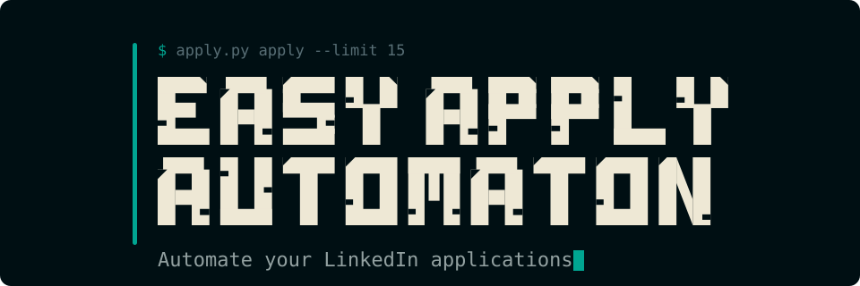
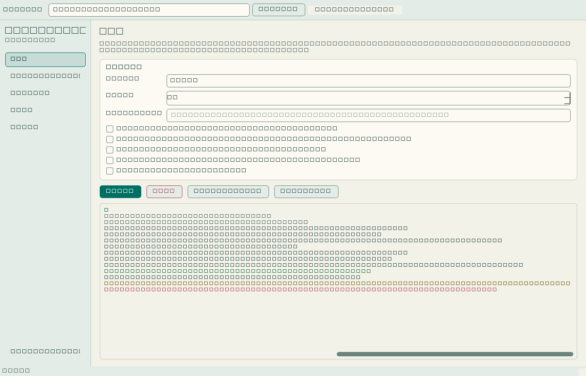
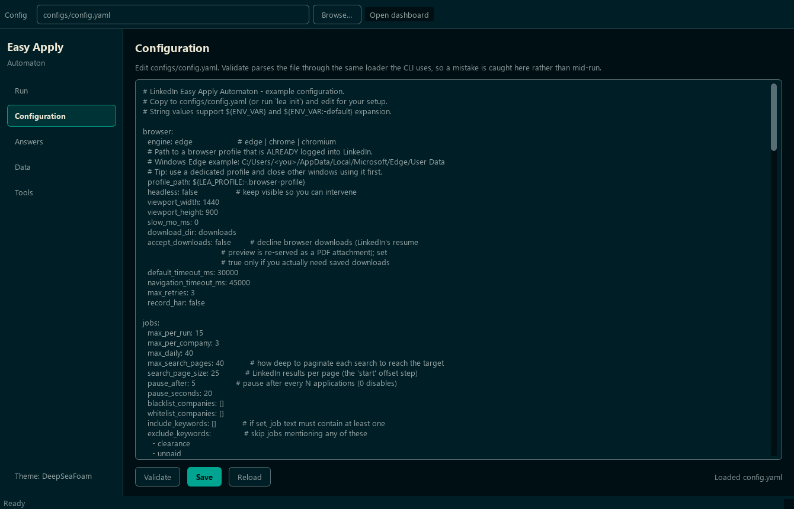
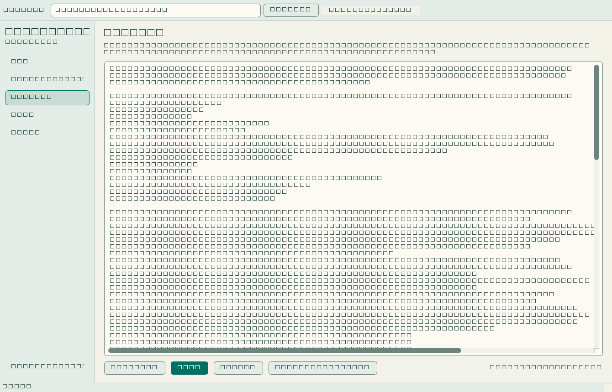
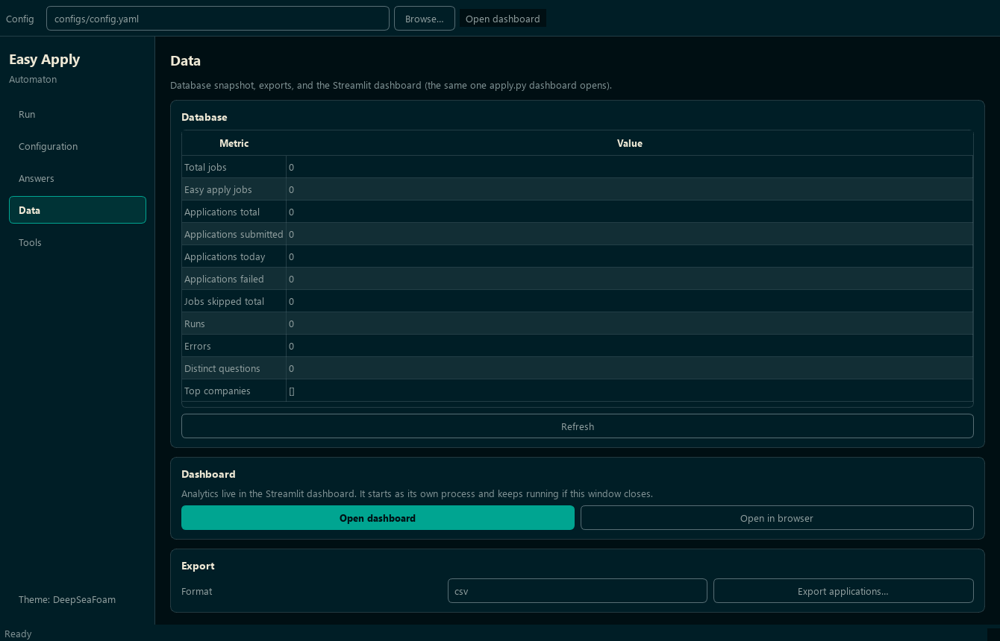
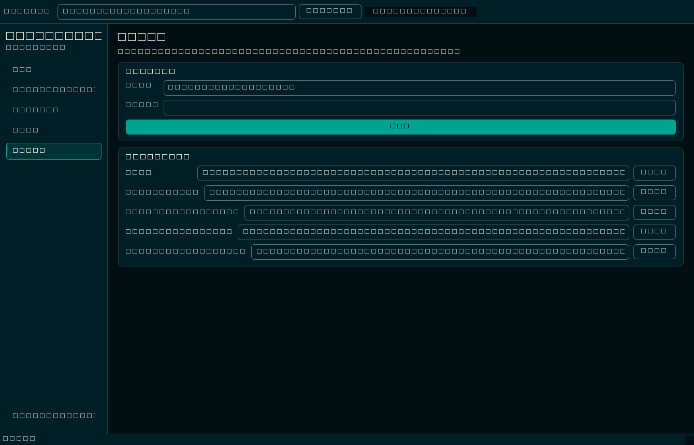
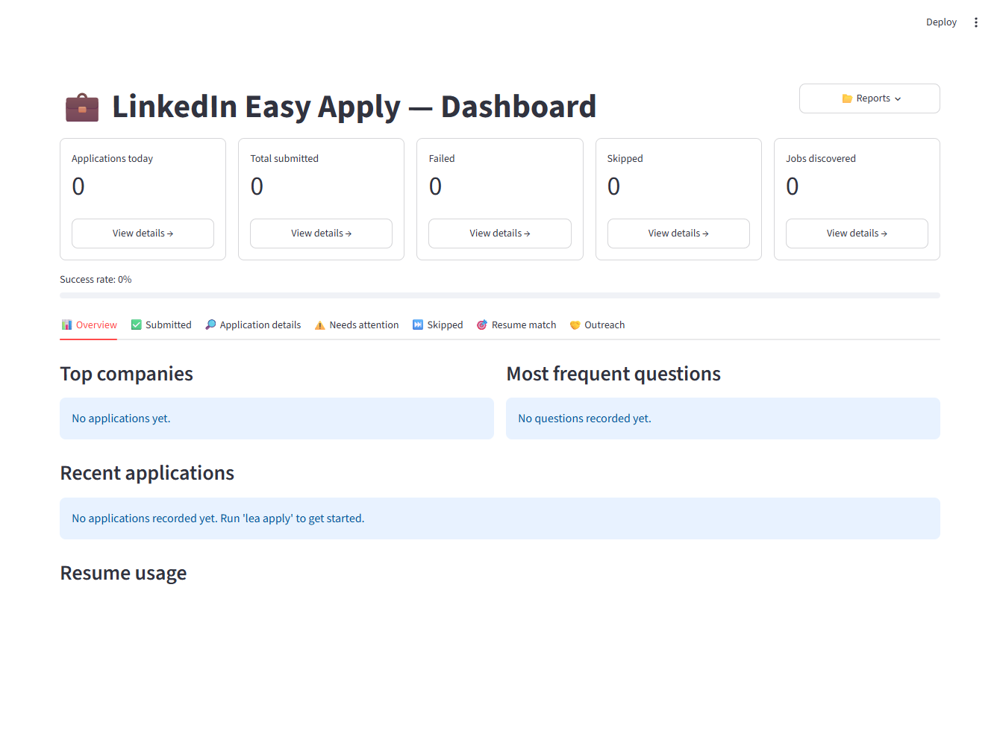

<p align="center">
  
</p>
<p align="center">
  
</p>
<p align="center">
  <a href="docs/setup-and-commands.md">Setup &amp; commands</a> &nbsp; · &nbsp;
  <a href="docs/gui.md">Desktop GUI</a> &nbsp; · &nbsp;
  <a href="docs/configuration.md">Configuration</a> &nbsp; · &nbsp;
  <a href="INIT.MD">Run guide</a> &nbsp; · &nbsp;
  <a href="docs/troubleshooting.md">Troubleshooting</a>
</p>

<div align="center">

**Discovers jobs from your searches, scores them against your criteria, picks the right résumé,
answers every question from your own answer file, and applies — in a window or from the terminal.**


</div>

> ⚠️ **Read this first.** Automating LinkedIn violates their Terms of Service and can get your account
> restricted. This project is provided for educational purposes; **use it at your own risk.** It never
> stores your password — you stay logged in through your own browser profile.

---

## Two front ends, one engine

The desktop app is a **front end for the CLI**, not a second implementation. Every button builds an
`apply.py` command, prints it to the log, and runs it — so the window and the terminal can never
drift apart.

```powershell
.\.venv\Scripts\python.exe apply.py gui            # drive it from a window
.\.venv\Scripts\python.exe apply.py apply -n 15    # drive it from the terminal
```

---

## Two themes

Dark **DeepSeaFoam** and light **Harbor Daylight**, switchable from the sidebar and remembered
between launches.

| Role | DeepSeaFoam (dark) | Harbor Daylight (light) |
| --- | --- | --- |
| Ambient field | `#000F13` | `#F3F2E9` |
| Panels | `#001E26` | `#E3ECE7` |
| Reading ink | `#93A1A1` | `#355451` |
| Headings | `#EEE8D5` | `#173D3A` |
| Accent | `#00A591` | `#006F63` |
| Status | `#45D072` · `#EBE565` · `#E84A5F` | `#247449` · `#77600E` · `#AD3E55` |

| DeepSeaFoam | Harbor Daylight |
| --- | --- |
|  |  |

Both palettes come from the [DeepSeaFoam](https://github.com/Zanark/DeepSeaFoam) design project.

---

## What you can do in the window

### Run — scan, apply, reapply, connect

Pick an action, set a limit, hit Start. The log streams live and colours each line by severity; Stop
terminates the run cleanly. **Copy command** puts the exact terminal equivalent on your clipboard.

### Configuration — edit and validate before you run

Validate parses your YAML **and** runs it through the same config model the CLI loads, so a bad value
is caught here instead of halfway through a crawl. Save refuses to write a file that does not validate.



### Answers — the file that fills the forms

The same editor for `answers.yaml`, whose path is read from your config. **Run sync-answers** grades
every recorded answer against your résumé and reports the drift.



### Data — statistics, export, dashboard

A live snapshot of the database, CSV/XLSX export, and the dashboard launcher.



### Tools — sign in, verify, inspect

One-shot commands plus every runtime folder — logs, screenshots, generated résumés, outreach reports,
search diagnostics — one click from Explorer.



---

## The analytics dashboard

A separate read-only Streamlit surface, opened from the GUI's Data page or `apply.py dashboard`.
Clickable KPI cards drill into any category; seven tabs cover submitted applications (expand any one
to replay what was asked, what was answered and which résumé went out), the questions that blocked an
application, **why** every skipped job was skipped, how well your answers match your résumé, and
drafted hiring-team outreach.



<sub>Shown on a fresh, empty database — the zeros are real, not a redaction.</sub>

---

## How it works

```
discover → extract → dedupe → filter → score → select résumé
        → (AI advise) → Easy Apply workflow → persist → learn answers
```

The `Orchestrator` coordinates focused modules (`config`, `parser`, `scoring`, `answers`, `forms`,
`browser`, `jobs`, `ai`, `database`). Playwright is imported lazily, so the pure-logic modules run
and unit-test without a browser.

---

## Highlights

- **Your browser, your session.** A Playwright persistent context reuses a profile you signed into by
  hand. No credentials, no automated login, no password ever stored.
- **Questions answered dynamically.** A hybrid keyword + fuzzy parser maps free-form Easy Apply
  questions onto your answer file. Unknown questions pause for input and are **remembered**; a
  `custom_questions` map pre-answers bespoke screening questions for unattended runs.
- **Weighted scoring you control.** Whole-word matching (so `go` ≠ `google`) and punctuation keywords
  (`c++`, `.net`), negative weights as vetoes, and an explainable per-job breakdown stored in the
  database. Set `scoring.enforce: false` or pass `--ignore-score` to keep the score as a signal
  without letting it skip anything.
- **Résumés that fit the job.** Picks the best PDF from `generated/resume/`, reuses an existing
  LinkedIn résumé card when present, or uploads. Opt into per-job **dynamic résumés** and the
  standalone [dynamic-resume-builder](https://github.com/Zanark/dynamic-resume-builder) re-emphasises
  your `master.yaml` for each posting — it never fabricates.
- **Safety rails.** Per-run, per-company and daily caps; blacklist/whitelist; include/exclude
  keywords; URL and company-role dedupe; LinkedIn's own daily cap detected and respected; graceful
  Ctrl+C.
- **Hiring-team outreach.** After a successful application, read each recruiter's name and profile
  URL, draft a full message **and** a ≤300-char connection note, and write a report for you to send
  by hand. Never clicks anything unless you opt into `mode: send`.
- **It tells you what it is thinking.** `-v` narrates every field: what was parsed, which answer
  resolved and *from where*, filled or skipped. When discovery finds nothing it reports why — page
  title, per-selector match counts, and a screenshot + HTML dump in `logs/diagnostics/`.
- **Everything persisted.** SQLite for jobs, applications, questions, scores, skips and errors, with
  learned-answer reuse, `stats`, and CSV/XLSX export.
- **Optional AI advisor** that only *advises* — it can never submit.
- Clean, typed, tested codebase (ruff + black + mypy + pytest).

---

## Quick start

```powershell
python -m venv .venv
.\.venv\Scripts\python.exe -m pip install -e ".[gui,dashboard]"

.\.venv\Scripts\python.exe apply.py init          # scaffold configs
.\.venv\Scripts\python.exe apply.py login         # sign in once, by hand
.\.venv\Scripts\python.exe apply.py scan          # discover + score, never applies
.\.venv\Scripts\python.exe apply.py gui           # or drive it from the window
```

📖 **Full setup, every command and every option: [docs/setup-and-commands.md](docs/setup-and-commands.md)**

---

## Documentation

| Guide | What's in it |
| --- | --- |
| **[Setup & Commands](docs/setup-and-commands.md)** | Install, extras, first run, and the complete command/option reference. |
| [Run Guide (INIT.MD)](INIT.MD) | Narrative walkthrough with copy-paste examples. |
| [Desktop GUI](docs/gui.md) | The window, its five pages, the themes, and how it maps onto the CLI. |
| [Configuration](docs/configuration.md) | Every file and key explained. |
| [Troubleshooting](docs/troubleshooting.md) | Fixes for common problems. |
| [FAQ](docs/faq.md) | Safety, AI, résumés, data storage. |
| [Résumé generation](generated/resume/README.md) | How the automaton gets the PDF it submits. |

### Learning the internals

Deep dives that teach the computer science behind this codebase and map it to patterns used at scale:

- [Run Lifecycle](docs/run-lifecycle.md) — one run, stage by stage, with the log lines you'll see.
- [Architecture & Design Patterns](docs/architecture.md) — diagrams, Functional-Core/Imperative-Shell,
  and every pattern used here with real code.
- [Data Structures](docs/data-structures.md) — the maps, sets, enums, DTOs and schema, with complexity.
- [Algorithms](docs/algorithms.md) — normalization, fuzzy matching, weighted scoring, backoff.
- [Résumé generation](docs/resume-studio.md) — why the builder is a standalone tool.

---

## Disclaimer

This software is not affiliated with, endorsed by, or connected to LinkedIn. Automating the platform
may violate LinkedIn's User Agreement and could lead to account restrictions. You are solely
responsible for how you use it.
