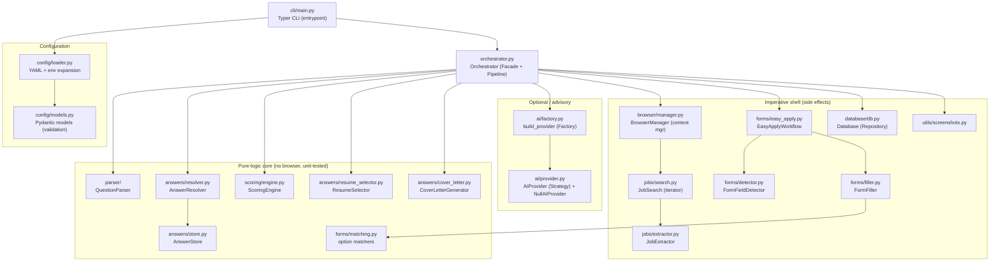
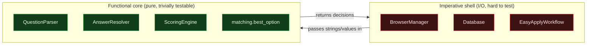
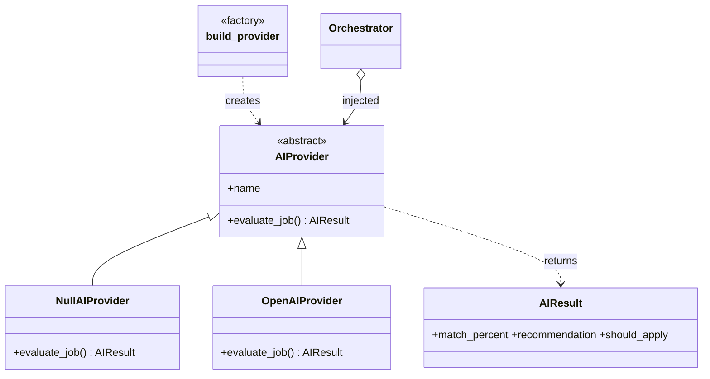
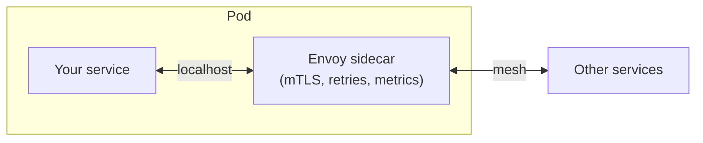
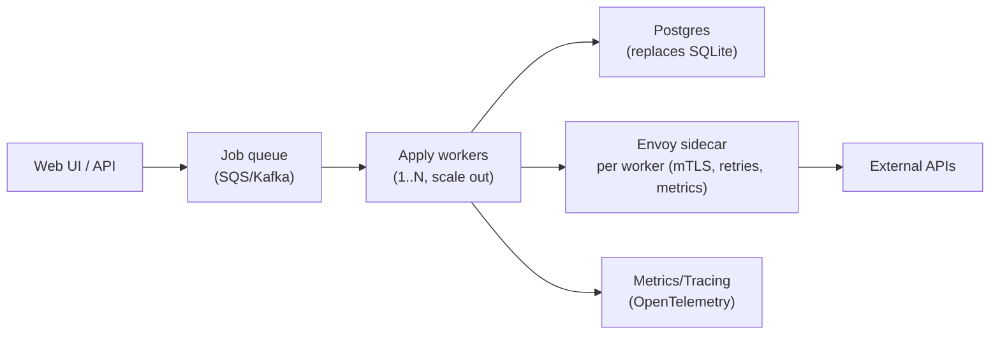

# Architecture & Design Patterns — a learning guide

> Written for an SDE growing toward architect. Every claim below points at **real
> code in this repo** (file · class · function) so you can open it and read.
> Where a pattern is used in industry, that's called out so you can map it to
> systems you'll meet at bigger companies.

## Contents

1. [The 10,000-foot view](#1-the-10000-foot-view)
2. [Every node explained (component diagram)](#2-every-node-explained)
3. [What happens on one run (sequence diagram)](#3-what-happens-on-one-run)
4. [The architectural *style*: Pipeline + Functional Core / Imperative Shell](#4-the-architectural-style)
5. [Design patterns actually used here](#5-design-patterns-actually-used-here)
6. [Cross-cutting concerns](#6-cross-cutting-concerns)
7. [Patterns we deliberately did NOT use (sidecar & friends)](#7-patterns-we-deliberately-did-not-use)
8. [How this would evolve to a distributed system](#8-how-this-would-evolve)
9. [Architect's takeaways](#9-architects-takeaways)

---

## 1. The 10,000-foot view

This is a **modular monolith**: one process, many small single-responsibility
modules, wired together by one coordinator (`orchestrator.py`). There is no
"god object" — the `Orchestrator` *coordinates*, it doesn't *do everything*.

The core insight to steal for your own designs:

> **Separate pure logic (no I/O) from side-effecting I/O.** Everything that
> decides *what* to do (parse a question, score a job, pick a resume, match an
> option) is pure and unit-tested without a browser. Everything that *touches the
> world* (Playwright, SQLite, filesystem) is isolated at the edges.

That single decision is why this codebase is testable, and it's the same idea
behind **"Functional Core, Imperative Shell"** (Gary Bernhardt) and **Hexagonal
/ Ports-and-Adapters** architecture (Alistair Cockburn) used across the industry.

---

## 2. Every node explained



| Node | File · symbol | Responsibility | Pure? |
| --- | --- | --- | :---: |
| **CLI** | `cli/main.py` · Typer `app` | Parse argv, load config, build the `Orchestrator`, print result tables. | I/O |
| **Orchestrator** | `orchestrator.py` · `Orchestrator` | The *only* thing that knows the whole flow. Runs the pipeline, enforces limits, persists. | I/O |
| **Config loader** | `config/loader.py` | Read YAML, expand `${ENV}`, hand to Pydantic. | pure-ish |
| **Config models** | `config/models.py` | Typed, validated settings (Pydantic). Rejects unknown keys. | pure |
| **QuestionParser** | `parser/question_parser.py` | Turn free-text question → `(category, skill, answer_type, confidence)`. | pure |
| **AnswerStore** | `answers/store.py` | In-memory, alias-aware view of *your* data. | pure |
| **AnswerResolver** | `answers/resolver.py` | Map a parsed question → a concrete value from the store. | pure |
| **ScoringEngine** | `scoring/engine.py` | Weighted-keyword score + pass/fail vs threshold. | pure |
| **ResumeSelector** | `answers/resume_selector.py` | Pick the best resume (mapping → overlap → default). | pure |
| **option matchers** | `forms/matching.py` | `best_option` / `boolean_option` for select/radio. | pure |
| **CoverLetterGenerator** | `answers/cover_letter.py` | Render a templated cover letter (Jinja2). | pure-ish |
| **BrowserManager** | `browser/manager.py` | Own the Playwright lifecycle; reuse your logged-in profile. | I/O |
| **JobSearch** | `jobs/search.py` | Drive a search URL, lazily *yield* jobs (generator). | I/O |
| **JobExtractor** | `jobs/extractor.py` | Read the detail pane → a `Job` value object. | I/O |
| **EasyApplyWorkflow** | `forms/easy_apply.py` | Multi-step form state machine: detect→fill→next→submit/discard. | I/O |
| **FormFieldDetector** | `forms/detector.py` | Discover fields + their options in the current step. | I/O |
| **FormFiller** | `forms/filler.py` | Type/select/check a field using the pure matchers. | I/O |
| **Database** | `database/db.py` | Repository over SQLite; intention-revealing methods. | I/O |
| **AIProvider / Factory** | `ai/*` | Optional advisor. Strategy chosen by a Factory; never submits. | I/O |

The **dotted line between "pure core" and "imperative shell" is the most
important boundary in the whole project.**

---

## 3. What happens on one run

```mermaid
sequenceDiagram
    participant U as You (CLI)
    participant O as Orchestrator
    participant B as BrowserManager
    participant S as JobSearch
    participant W as EasyApplyWorkflow
    participant DB as Database

    U->>O: run(mode, dry_run, limit)
    O->>DB: start_run()  (returns run_id)
    O->>B: with BrowserManager(...)  (opens Edge, reuses session)
    loop each enabled search
        O->>S: iterate(url, cap)
        loop each job (lazy yield)
            S-->>O: Job
            O->>DB: upsert_job()
            O->>O: score + pre-apply gates
            alt gated or below threshold
                O->>DB: record_score(); note_skip
            else eligible
                O->>O: select resume, (AI advise)
                O->>W: apply(resume, cover)
                W-->>O: ApplyResult (submitted/dry_run/failed)
                O->>DB: update_application(); record_answers()
            end
        end
    end
    O->>DB: finish_run()
    O-->>U: RunSummary (scanned/applied/skipped/failed)
```

Read `Orchestrator.run` → `_execute` → `_process_job` in `orchestrator.py` — the
sequence above is literally those three methods.

---

## 4. The architectural style

### 4a. Pipeline (a.k.a. Pipes and Filters)

The run is a **linear pipeline**; each stage transforms/filters the item and
passes it on:

```
discover → extract → deduplicate → filter (gates) → score → select resume
        → (AI advise) → fill & submit → persist → learn
```

This is the same style as **Unix pipes** (`grep | sort | uniq`), **CI/CD
pipelines**, **ETL jobs**, and **compilers** (lex → parse → optimize → codegen).
Why architects like it: each stage is independently testable and replaceable,
and the data contract between stages is explicit (here, the `Job` object).

### 4b. Functional Core, Imperative Shell



Evidence it's real: `tests/` exercise parser, scoring, resolver, matching, resume
selection **with no browser installed**, because Playwright is imported *inside
functions* (`browser/manager.py` `start()` does `from playwright... import`), not
at module top. That lazy import is a deliberate **dependency inversion** so the
core never transitively imports the shell.

---

## 5. Design patterns actually used here

Each entry: what it is → **where** in this repo → where you'll meet it in industry.

### Facade — `Orchestrator`
One simple entrypoint (`run()`) hides a complicated subsystem (browser, parser,
scorer, DB…). The CLI never talks to Playwright directly.
*Industry:* service-layer classes in Spring/.NET; an API gateway is a facade at
network scale.

### Strategy — `AIProvider`
```python
# ai/provider.py
class AIProvider(ABC):
    @abstractmethod
    def evaluate_job(self, *, job_title, job_description, resume_text=None) -> AIResult: ...
```
Interchangeable algorithms behind one interface (`NullAIProvider`,
`OpenAIProvider`). Swap behavior without touching callers.
*Industry:* payment gateways, `java.util.Comparator`, pluggable auth backends.

### Factory — `build_provider`
```python
# ai/factory.py
def build_provider(config) -> AIProvider:
    if not config.enabled: return NullAIProvider()
    if config.provider is AIProviderName.OPENAI: return OpenAIProvider(config)
```
Centralizes "which concrete class do I construct?" so callers depend only on the
interface. *Industry:* `LoggerFactory`, driver factories, Spring `@Bean` methods.

### Null Object — `NullAIProvider`
Instead of `if ai is not None:` everywhere, a **do-nothing implementation** that
returns a neutral `AIResult(should_apply=None)`. The orchestrator calls it
unconditionally. *Industry:* `NullLogger`, `Collections.emptyList()`, guava's
`Optional` neighbors. A textbook example — study it.

### Repository (+ a dash of Data Mapper) — `Database`
```python
# database/db.py
def has_applied_to_url(self, url) -> bool: ...
def upsert_job(self, job: dict, run_id) -> int: ...
```
The rest of the app speaks **domain intent** ("have I applied to this URL?"), not
SQL. The mapping between the `Job` object and table columns lives in one place
(`Job.to_db_dict` + `upsert_job`). *Industry:* Spring Data repositories, .NET EF,
Rails ActiveRecord (an *active-record* variant of the same idea).

### Dependency Injection (constructor injection) — `Orchestrator.__init__`
```python
def __init__(self, config, database, answers, *, on_unknown=None,
             on_confirm_submit=None, ai_provider=None): ...
```
Collaborators are *passed in*, not created inside. That's why tests can inject a
fake DB or a stub AI. *Industry:* Spring, Guice, .NET's built-in DI container.
The `on_unknown` / `on_confirm_submit` callables are also **injected policy**
(a lightweight Strategy) so the CLI decides how to prompt.

### Context Manager / RAII — `BrowserManager`, `Database.connect`
```python
with BrowserManager(cfg.browser) as browser:   # __enter__ opens, __exit__ closes
    ...
```
Deterministic acquire/release even on exceptions. Python's `with` == Java
try-with-resources == C++ RAII == Go `defer`. `Database.connect` uses
`@contextmanager` to **commit on success, rollback on error, always close** —
the Unit-of-Work boundary in miniature.

### Decorator — `retry`
```python
# utils/retry.py
@retry(attempts=3, backoff_seconds=1.0, backoff_factor=2.0)
def flaky(): ...
```
Wrap a function to add cross-cutting behavior (retry + backoff) without editing
its body. *Industry:* resilience4j/Polly retry decorators, `@lru_cache`,
Flask/Express middleware.

### Iterator / Generator — `JobSearch.iterate`
Yields jobs **lazily** so the pipeline processes job *N* while job *N+1* hasn't
been fetched yet, and memory stays flat. *Industry:* DB cursors, Kafka consumer
loops, paginated API iterators.

### Value Object / DTO — the `@dataclass(slots=True)` family
`Job`, `ParsedQuestion`, `ScoreResult`, `ResumeChoice`, `AnswerResolution`,
`FormField`, `RunSummary`. Immutable-ish, equality-by-value carriers between
stages. *Industry:* DTOs/records everywhere (Java `record`, Kotlin `data class`).

### Guard clauses (a cousin of Chain of Responsibility) — `_pre_apply_checks`
```python
if not job.easy_apply: return "not_easy_apply"
if job.already_applied or self._db.has_applied_to_url(job.url): return "already_applied"
...
return None   # passed all gates
```
A short-circuiting chain of checks that each return a *reason*. Not a full GoF
Chain of Responsibility (no linked handler objects), but the same spirit and
far more readable than nested `if`s. *Industry:* request-validation middleware,
feature-flag gating, auth policy chains.

### Class diagram — the AI strategy/factory slice



---

## 6. Cross-cutting concerns

| Concern | How it's handled | Pattern / industry analog |
| --- | --- | --- |
| **Logging** | Centralized Loguru setup (`logging/setup.py`), one sink config, INFO narrative + DEBUG internals, `-v` flag. | Cross-cutting concern / AOP-lite; ELK/Datadog pipelines. |
| **Configuration** | YAML + `${ENV}` expansion + Pydantic validation; secrets by env-var *name*, never value. | 12-Factor App config; `application.yml` + `@ConfigurationProperties`. |
| **Error handling** | try/except at the orchestrator boundary; failures logged to the `errors` table, run marked `failed`, exception re-raised. | Bulkhead-ish isolation; dead-letter logging. |
| **Observability** | Per-step & on-error screenshots (`utils/screenshots.py`), the `runs`/`errors` tables, verbose logs. | Tracing/telemetry; artifacts on CI failure. |
| **Safety governance** | AI can only *advise* (`_advise` returns `False` only to veto-skip, never to force). Dry-run discards instead of submitting. | "Recommendations without authority"; kill-switch / guardrail design. |

---

## 7. Patterns we deliberately did NOT use

You asked specifically about the **sidecar** pattern — great instinct, so here's
an honest map of what *isn't* here and *why*. Knowing when **not** to reach for a
pattern is a senior/architect skill (avoiding "resume-driven development").

### Sidecar
A **sidecar** is a *second process* deployed **next to** your app (same
pod/host) that handles cross-cutting infrastructure — TLS, retries, metrics,
service discovery — so your app doesn't have to. The famous example is **Envoy**
running beside every service in an **Istio/Linkerd service mesh**; also log
shippers (Fluent Bit) and secret agents (Vault agent).



**Why not here:** a sidecar solves *inter-service networking* for many services.
This is a **single-user desktop CLI with zero network services of its own** — it
talks to LinkedIn through a browser. A sidecar would be pure overhead. The retry
concern a sidecar would own is instead a small in-process **Decorator**
(`utils/retry.py`) — the right-sized tool.

### Other patterns intentionally absent

| Pattern | What it's for | Why skipped here |
| --- | --- | --- |
| **Circuit Breaker** | Stop hammering a failing dependency (Hystrix/resilience4j). | We only have one dependency (the browser) and a human watching; retry+backoff is enough. *This is the most likely next upgrade.* |
| **Microservices** | Independent deploy/scale of many teams' services. | One user, one process. Splitting would add ops cost for zero benefit. |
| **Event-driven / Pub-Sub / CQRS** | Decouple producers/consumers, scale reads/writes separately. | The flow is a simple synchronous pipeline; SQLite is plenty. |
| **Ambassador / API Gateway** | A proxy that brokers outbound/inbound calls. | No service surface to broker. |

> **Lesson:** patterns are answers to *forces* (scale, team size, failure modes,
> latency). If the force isn't present, the pattern is just complexity. Reach for
> them when the pain shows up — not before.

---

## 8. How this would evolve

If this became a **multi-user hosted service**, the forces change and the
patterns above start to earn their keep:



- **SQLite → Postgres** once you need concurrent writers (the `Database`
  repository boundary means callers barely change — that's the payoff of the
  Repository pattern).
- **Synchronous loop → queue + workers** for throughput and isolation.
- **Retry decorator → Circuit Breaker** across the network boundary.
- **Sidecar** now makes sense: give each worker an Envoy sidecar for mTLS,
  retries, and metrics — exactly the job it was designed for.

Notice you'd **keep the entire functional core unchanged**. Only the shell
changes. That's the dividend of the boundary in §4.

---

## 9. Architect's takeaways

1. **Draw the pure/impure line first.** It dictates testability and future
   flexibility more than any framework choice.
2. **Coordinate, don't centralize.** One orchestrator that *calls* focused
   modules beats one class that *contains* everything.
3. **Depend on interfaces at the seams** (AIProvider, Repository, injected
   callbacks) so pieces are swappable and fakeable.
4. **Right-size patterns to forces.** The sidecar/circuit-breaker/microservice
   toolbox is real, but a single-user CLI correctly uses none of them.
5. **Make the boundary cheap to cross later.** Repository + DI mean "SQLite →
   Postgres" and "loop → workers" are localized changes, not rewrites.

**Keep learning by reading, in this order:** `orchestrator.py` (the whole story)
→ `ai/provider.py` + `ai/factory.py` (Strategy+Factory+Null Object in ~40 lines)
→ `database/db.py` (Repository + Unit of Work) → `browser/manager.py` (Context
Manager + lazy import).

See also: [`data-structures.md`](data-structures.md) ·
[`algorithms.md`](algorithms.md) · [`developer_guide.md`](developer_guide.md).
