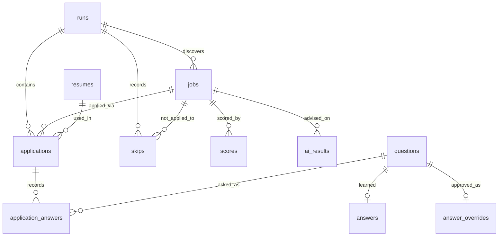

# Data Structures — what this project uses, and where industry uses them

> Every structure below is used in **this repo** (file · symbol cited) with the
> reason it was chosen, its complexity, and a real-world/industry parallel so the
> knowledge transfers to systems at scale.

## Contents

1. [Hash map / dictionary](#1-hash-map--dictionary-dict)
2. [Set](#2-set)
3. [Tuple (immutable sequence)](#3-tuple-immutable-sequence)
4. [Enum / StrEnum](#4-enum--strenum)
5. [Dataclass value objects (with `slots`)](#5-dataclass-value-objects)
6. [Pydantic models (validated records)](#6-pydantic-models)
7. [Sorted list for longest-match](#7-sorted-list-for-longest-match)
8. [Lazy stream (generator/iterator)](#8-lazy-stream-generatoriterator)
9. [The relational schema (B-tree indexes, FKs, JSON columns)](#9-the-relational-schema)
10. [Structures we did NOT use (and when you would)](#10-structures-we-did-not-use)
11. [Cheat-sheet table](#11-cheat-sheet)

---

## 1. Hash map / dictionary (`dict`)

The workhorse. Average **O(1)** insert/lookup by key.

**Where in this repo**

| Use | Location |
| --- | --- |
| Category → ordered answer keys | `answers/resolver.py` · `_FIELD_MAP`, `_BOOL_MAP` |
| Category → default answer type | `parser/categories.py` · `DEFAULT_ANSWER_TYPE` |
| Category → fuzzy phrases | `parser/question_parser.py` · `_PHRASES` |
| Skill → years of experience | `answers/store.py` · `self._skill_years` |
| Alias → canonical field | `answers/store.py` · `self._aliases` |
| Matched keyword → weight | `scoring/engine.py` · `ScoreResult.breakdown` |

**Why chosen:** these are all "given a key, get a value fast" lookups. A dict
turns what could be an O(n) scan into O(1). Example — the resolver maps a
`QuestionCategory` to the list of `answers.yaml` keys to try:

```python
# answers/resolver.py
_FIELD_MAP = {
    QuestionCategory.EXPERIENCE_TOTAL: ("years_experience", "total_experience"),
    QuestionCategory.SALARY_EXPECTED: ("expected_ctc", "expected_salary"),
    ...
}
```

**Industry parallels:** routing tables (URL → handler), in-memory caches
(Redis is a networked hash map), symbol tables in compilers, memoization,
database hash indexes, `HashMap`/`ConcurrentHashMap` in Java, config lookups.
Understanding hash collisions, load factor, and why keys must be hashable/
immutable is a common interview and design topic.

---

## 2. Set

Unordered collection with **O(1)** membership testing and automatic dedupe.

**Where in this repo**

| Use | Location |
| --- | --- |
| Reserved YAML keys (skip them) | `answers/store.py` · `_RESERVED` |
| Truthy / falsy tokens | `answers/store.py` · `_TRUTHY`, `_FALSY`; `forms/matching.py` · `_YES`, `_NO` |
| Skill vocabulary (dedup + fast lookup) | `parser/question_parser.py` · `vocab = {normalize(s) ...}` |
| **Visited job IDs during discovery** | `jobs/search.py` · `seen: set[str]` |
| Valid resume file extensions | `answers/resume_selector.py` · `_RESUME_SUFFIXES` |

**Why chosen:** the star example is the crawler dedupe in `JobSearch._collect_ids`:

```python
# jobs/search.py
ordered: list[str] = []
seen: set[str] = set()          # O(1) "have I seen this job id?"
for job_id in self._current_ids():
    if job_id not in seen:
        seen.add(job_id)
        ordered.append(job_id)  # list preserves discovery order
```

Note the **set + list pairing**: the `set` answers "seen it?" in O(1) while the
`list` preserves *order*. That combo is a classic idiom (an ordered de-dupe).

**Industry parallels:** the **visited set** is fundamental to every web crawler
(Googlebot), graph traversal (BFS/DFS), and stream de-duplication. Membership
sets back spam blocklists, feature flags, and permission checks.

---

## 3. Tuple (immutable sequence)

Ordered, **immutable** → safe to share as a constant, hashable, slightly leaner
than a list.

**Where in this repo**

- `parser/question_parser.py` · `_DEFAULT_SKILLS: tuple[str, ...]` — a fixed
  vocabulary that must never be mutated at runtime.
- `answers/resolver.py` · the **values** of `_FIELD_MAP` are tuples of keys to
  try *in order* (`("expected_ctc", "expected_salary")`) — order encodes
  priority.

**Why chosen:** immutability communicates intent ("this is a constant") and
prevents accidental mutation of shared state — a real source of bugs in larger
codebases. **Industry parallel:** returning tuples/records as immutable results;
`final`/`readonly` fields; frozen configs.

---

## 4. Enum / StrEnum

A closed set of named values. `StrEnum` members *are* strings, so they serialize
straight into YAML/SQLite yet stay type-checked in code.

**Where in this repo**

| Enum | File | Domain it closes |
| --- | --- | --- |
| `AnswerType` | `parser/categories.py` | text/number/boolean/date/choice/email/phone/url/file |
| `QuestionCategory` | `parser/categories.py` | ~29 semantic question types |
| `FieldKind` | `forms/field.py` | text/textarea/number/select/radio/checkbox/date/file |
| `ApplyStatus` | `forms/easy_apply.py` | submitted/dry_run/skipped/failed… |
| `BrowserEngine`, `AIProviderName` | `config/models.py` | chrome/edge/chromium; none/openai |

**Why chosen:** replacing magic strings with an enum means the type checker
catches typos, and `match`/dict lookups over a *finite* domain are exhaustive and
safe. Example — every category has exactly one default type:

```python
# parser/categories.py
DEFAULT_ANSWER_TYPE: dict[QuestionCategory, AnswerType] = {
    QuestionCategory.SALARY_EXPECTED: AnswerType.NUMBER,
    QuestionCategory.WORK_AUTHORIZATION: AnswerType.BOOLEAN,
    ...
}
```

**Industry parallels:** status columns (`order.status`), protocol/opcode enums,
state-machine states, gRPC/protobuf enums, `enum`/`sealed` types in Java/Kotlin/
Rust. Choosing an enum vs a free string is a recurring modeling decision.

---

## 5. Dataclass value objects

`@dataclass(slots=True)` gives you a lightweight, typed **record** with
value-equality, a free constructor, and (via `slots`) lower memory + faster
attribute access (no per-instance `__dict__`).

**Where in this repo** — the DTOs that flow between pipeline stages:

| Dataclass | File | Role |
| --- | --- | --- |
| `Job` | `jobs/models.py` | The item flowing through the pipeline |
| `ParsedQuestion` | `parser/question_parser.py` | Parser output |
| `AnswerResolution` | `answers/resolver.py` | Resolver output |
| `ScoreResult` | `scoring/engine.py` | Scorer output |
| `ResumeChoice` | `answers/resume_selector.py` | Selector output |
| `Expectation` / `GradedAnswer` | `answers/resume_expectations.py` | Résumé-grading verdict + a graded answer row |
| `FormField` | `forms/field.py` | One detected field |
| `RunSummary` | `orchestrator.py` | Aggregate run outcome |

```python
# jobs/models.py
@dataclass(slots=True)
class Job:
    url: str
    title: str | None = None
    company: str | None = None
    easy_apply: bool = False
    ...
    def to_db_dict(self) -> dict[str, Any]:   # DTO → persistence shape
        return asdict(self)
```

**Why `slots=True` matters:** if you discover 30 jobs × many fields, `__slots__`
avoids a dict per instance. Small here, but the *habit* scales to hot paths.

**Industry parallels:** DTOs/records at API and service boundaries (Java
`record`, Kotlin `data class`, C# `record`, Python `@dataclass`/`pydantic`,
protobuf messages). Value objects are a core **Domain-Driven Design** building
block.

---

## 6. Pydantic models

`config/models.py` defines the config as **validated** typed records. Unknown
keys are rejected, types are coerced/checked, defaults are declared once.

**Why chosen:** configuration is untrusted input. Validating it *at the edge*
(load time) means the rest of the code can assume well-formed data — a
"parse, don't validate" discipline. **Industry parallels:** FastAPI request
models, Spring `@ConfigurationProperties` + JSR-303, JSON Schema validation,
protobuf/Avro schemas. This is the "**make illegal states unrepresentable**"
idea in practice.

---

## 7. Sorted list for longest-match

`QuestionParser.__init__` sorts the skill vocabulary **longest-first**:

```python
# parser/question_parser.py
self._skills = sorted((s for s in vocab if s), key=len, reverse=True)
```

So `"spring boot"` is tested before `"spring"`, and `"core java"` before
`"java"` — the most specific match wins. The list is the right structure because
**iteration order encodes priority**.

**Industry parallels:** maximal-munch **lexers/tokenizers** (match the longest
token), **URL routers** (most-specific route first), dictionary-based **word
segmentation** in NLP, and longest-prefix matching in IP routing tables.

---

## 8. Lazy stream (generator/iterator)

`JobSearch.iterate` is a **generator** — it `yield`s one `Job` at a time instead
of building a giant list:

```python
# jobs/search.py
def iterate(self, url, search_name, max_jobs) -> Iterator[Job]:
    self.open(url)
    for job_id in self._collect_ids(max_jobs)[:max_jobs]:
        ...
        yield self._extractor.extract(self._page, search_name=search_name)
```

**Why chosen:** memory stays flat (O(1) w.r.t. total jobs), the consumer can stop
early (the orchestrator breaks when it hits `max_per_run`), and work is
*pull-based* — job N+1 is never fetched until stage 1 asks for it. The
`scan_cap = max(max_per_run*5, 30)` in the orchestrator is a **bounded buffer**
guard so discovery can't run away.

**Industry parallels:** database **cursors**, paginated API iterators, Kafka
consumer loops, Node.js streams, Java `Stream`/`Iterator`, Python's own file
iteration. Streaming vs. materializing is a constant scalability decision.

---

## 9. The relational schema

`database/sql/schema.sql` is itself a set of data structures. The logical model:



Structures at play inside the DB:

- **B-tree indexes** — every `CREATE INDEX` (e.g. `idx_jobs_company`,
  `idx_applications_status`) builds a balanced search tree giving **O(log n)**
  lookups/range scans. `PRIMARY KEY`/`UNIQUE` are backed by B-trees too.
- **Uniqueness constraints as invariants** — `jobs.url UNIQUE`,
  `questions.normalized UNIQUE`, `applications UNIQUE(job_id, run_id)`. These are
  data-structure guarantees enforced by the engine, not app code.
- **Foreign keys as edges** — the schema is a graph; `ON DELETE CASCADE`/`SET
  NULL` define what happens to edges when a node is removed.
- **JSON columns (semi-structured)** — `scores.breakdown`, `runs.searches`,
  `ai_results.reasons` store lists/maps as JSON text: a pragmatic hybrid of
  relational + document models (like Postgres **JSONB**).
- **A persisted key-value knowledge base** — `questions` ⟷ `answers` is a learned
  cache: a manually answered question is stored and reused in O(1)-ish lookups on
  future runs (`get_known_answer` keyed by `normalized`). This is **memoization
  made durable** / a human-in-the-loop feedback store.
- **An approved-override layer** — `answer_overrides` is a second key-value store
  keyed by `questions.normalized UNIQUE`, holding user-vetted corrections. It is
  read **first** at fill time (`get_answer_override`, ahead of `answers.yaml` and
  the learned `answers` table), so approving a fix in the *Resume match* tab /
  `sync-answers` durably overrides what the bot will submit next — a priority
  cache in front of the defaults.

- **An append-only skip log** — `skips` records one row per job the pipeline
  chose *not* to apply to, tagged with a `reason` and LEFT-JOINed to its `job`
  for the dashboard's **Skipped** analytics (`record_skip` / `skip_events`). It's
  deliberately kept out of `applications` so it never perturbs submit / reapply /
  stats logic; the aggregate also lives in `runs.jobs_skipped` for history.

**Upsert as a structure operation:** `INSERT ... ON CONFLICT(...) DO UPDATE`
(`upsert_job`, `create_application`, `learn_answer`) is the SQL "put into a map"
— insert-or-replace keyed by a unique column. (SQL Server calls it `MERGE`.)

**Anti-join as set difference:** `reapply_targets` (which backs the *Reapply
all* button) is the set of jobs with a `failed`/`aborted` application **minus**
the set that was ever `submitted`. That "A but not B" is expressed with `WHERE
NOT EXISTS (SELECT 1 FROM applications s WHERE s.job_id = j.id AND s.status =
'submitted')` — a correlated **anti-join**, the relational spelling of set
difference (`GROUP BY` then de-dupes the survivors to one row per job).

**Industry parallels:** this is standard OLTP schema design — normalized tables,
B-tree indexes, referential integrity, and a JSON escape hatch for flexible
fields, exactly as you'd model in Postgres/MySQL for an ATS, CRM, or orders
service.

---

## 10. Structures we did NOT use

Knowing the alternative — and why it wasn't needed — is the valuable part.

| Structure | What it's great at | Why not here / when to reach for it |
| --- | --- | --- |
| **Trie / Aho-Corasick automaton** | Matching **thousands** of keywords in one pass over text (O(text)). | Our scoring/skill lists are tiny (dozens), so per-keyword regex word-boundary scans are simpler and fast enough. Reach for a trie/Aho-Corasick for large dictionaries — intrusion detection, profanity/PII filters, search autocomplete. |
| **Heap / priority queue** | Always pop the "best" item; top-K. | Jobs are processed in discovery order with early-exit limits, not by global priority. A heap would matter if you ranked *all* jobs and applied to the top-K. |
| **Graph adjacency list** | Explicit graph traversal. | The dependency/pipeline "graph" is implicit in function calls; no runtime graph object is needed. |
| **Bloom filter** | Probabilistic membership at massive scale with tiny memory. | The visited-set fits easily in memory; a Bloom filter earns its keep at crawler scale (billions of URLs). |
| **LRU cache** | Bound memory of a cache. | The learned-answers store is small and *durable* (SQLite), so no eviction policy is needed yet. |

---

## 11. Cheat-sheet

| Structure | Repo example | Big-O highlight | Learn-it-because |
| --- | --- | --- | --- |
| `dict` | `_FIELD_MAP`, `_skill_years` | O(1) lookup | caches, indexes, routing |
| `set` | `seen` job ids | O(1) membership | crawlers, dedupe, BFS/DFS |
| `tuple` | `_DEFAULT_SKILLS` | immutable, ordered | safe shared constants |
| `Enum` | `QuestionCategory` | finite domain | status/state modeling |
| `@dataclass` | `Job`, `ScoreResult` | value objects | DTOs, DDD |
| Pydantic model | `AppConfig` | validated at edge | parse-don't-validate |
| sorted list | parser skills | priority by order | lexers, routers |
| generator | `JobSearch.iterate` | O(1) memory | cursors, streams |
| B-tree index | `idx_jobs_company` | O(log n) | database tuning |
| upsert | `upsert_job` | put-if-absent | ETL/sync/idempotency |

See also: [`algorithms.md`](algorithms.md) · [`architecture.md`](architecture.md).
