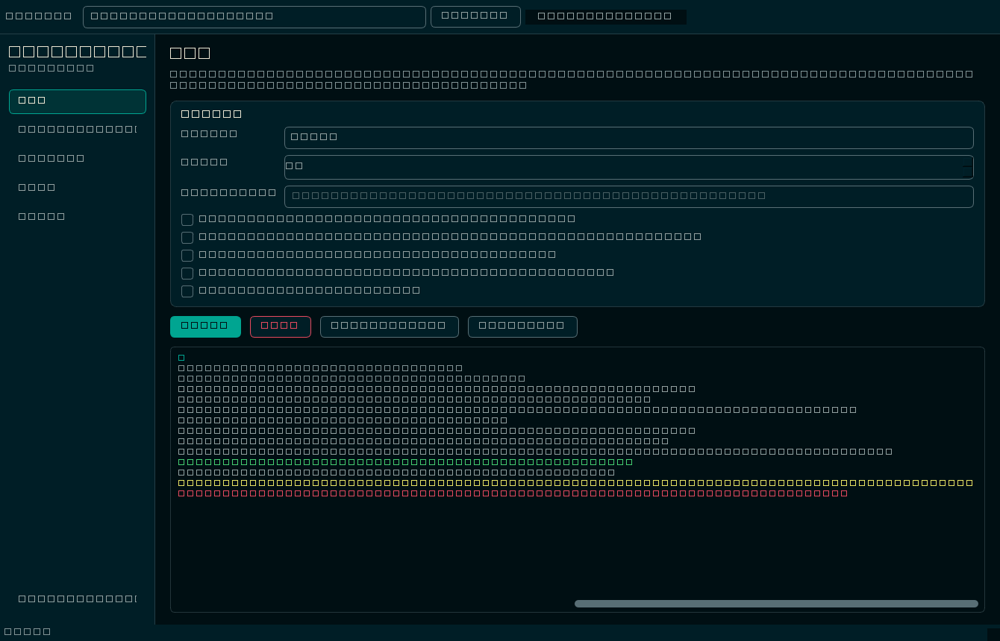

# Desktop GUI

A native window over the same automation the CLI drives. Nothing is
reimplemented: every button builds an `apply.py <command>` line, echoes it into
the log, and runs it. Anything you can do in the GUI you can do in a terminal,
and vice versa. For the commands themselves see
[Setup & Commands](setup-and-commands.md).



```powershell
pip install .[gui]          # adds PySide6
.\.venv\Scripts\python.exe apply.py gui
```

Options:

| Flag | Meaning |
| --- | --- |
| `--config`, `-c` | Config file handed to every command it runs (default `configs/config.yaml`). |
| `--theme` | `deepseafoam` (dark) or `harbor-daylight` (light). Omit to reuse the last one. |

Without PySide6 installed, `apply.py gui` prints an install hint and exits `2`.
The rest of the CLI is unaffected — the Qt dependency is optional and imported
lazily.

## The five pages

**Run** — choose Scan, Apply, Reapply or Connect, set the limit, optionally
override the search URL, then Start. The log streams live and colours each line
by its loguru level. **Stop** terminates the child process (escalating to a kill
if it ignores the request). **Copy command** puts the exact equivalent terminal
command on the clipboard.

Guards worth knowing:

- A real (non-dry-run) **Apply** asks for confirmation first — it submits real
  applications.
- Per-submit confirmation is disabled in the GUI: that prompt needs a terminal
  to answer it, so GUI runs always pass `--no-confirm-submit --yes`. Use the CLI
  when you want to approve each submit by hand.
- Flags that an action does not support are disabled rather than silently
  dropped — `--url` is greyed out for Reapply, `--ignore-score` for Scan, and so
  on.
- The hiring-team outreach checkbox is tri-state: partially checked means "use
  the `outreach.enabled` config value" rather than forcing either flag.

**Configuration** — edit `config.yaml` in place. **Validate** parses the YAML
*and* runs it through the same `AppConfig` model the CLI loads, so a bad value is
caught here instead of halfway through a run. Save refuses to write a file that
does not validate.

**Answers** — the same editor for your answers file, whose path is read from
`answers.file` in the config. Validation here is YAML-syntax only; content
quality is what **Run sync-answers** checks (it runs the CLI command and shows
the report in the Run log).

**Data** — a live snapshot of the database `stats()`, an export button
(CSV/XLSX), and the dashboard launcher.

**Tools** — one-shot commands: sign in, verify the browser session, scaffold
configs, preview a résumé choice, recognise a question. Also a list of the
runtime directories (logs, screenshots, generated résumés, outreach reports,
search diagnostics) with buttons to open them in Explorer.

## Dashboard from either side

The Streamlit dashboard stays a separate, read-only analytics surface. Open it
whichever way suits you:

```powershell
.\.venv\Scripts\python.exe apply.py dashboard     # from the CLI
```

or from the GUI's **Data → Open dashboard** button (also <kbd>Ctrl</kbd>+<kbd>D</kbd>
from anywhere in the window). The GUI starts it as a *detached* process and opens
`http://localhost:8501`, so it keeps running even if you close the window;
pressing the button again just reopens the browser tab. It needs the dashboard
extra (`pip install .[dashboard]`).

## Themes

Both themes come from the [DeepSeaFoam](https://github.com/Zanark/DeepSeaFoam)
project and are transcribed in `linkedin_easy_apply/gui/theme.py` as *semantic
roles*, not copied field names, per that project's porting rules.

| | DeepSeaFoam (dark) | Harbor Daylight (light) |
| --- | --- | --- |
| Ambient field | `#000F13` base | `#F3F2E9` background |
| Panels | `#001E26` panel | `#E3ECE7` surface |
| Raised / inputs | `#001E26` (no third dark surface exists) | `#FCFAF2` paper |
| Reading ink | `#93A1A1` | `#355451` |
| Lower emphasis | `#839496` faintText | `#536B66` muted |
| Headings | `#EEE8D5` warm | `#173D3A` heading |
| Accent | `#00A591` | `#006F63` |
| Primary-action hover | `#93A1A1` (text's documented second role) | `#00594F` accentHover |
| Status | `#45D072` / `#EBE565` / `#E84A5F` | `#247449` / `#77600E` / `#AD3E55` |

Switch with the button at the bottom of the sidebar; the choice is remembered
through `QSettings`.

Two porting details the code handles deliberately:

- **Alpha position.** The palettes publish translucent tokens as CSS
  `#RRGGBBAA` (alpha last), but Qt reads 8-digit hex as `#AARRGGBB` (alpha
  first). `theme.qt_color()` converts every such token to `rgba(r, g, b, a)`;
  a test asserts no 8-digit hex survives into the generated stylesheet.
- **Roles are not interchangeable.** DeepSeaFoam has no second accent fill — its
  `text` role is documented as "primary text *and primary-action hover*", so
  that is what the dark theme's hovered primary button uses, with the near-black
  base as the ink on top. Harbor Daylight has a real `accentHover` solid and
  uses paper as button ink.

This is an application of the published palettes, not a native DeepSeaFoam
target or a contrast certification. Harbor Daylight's documented contrast
figures cover its own specified pairs; they are not a blanket guarantee for
every composite rendered here.

## Module layout

| Module | Qt? | Purpose |
| --- | --- | --- |
| `gui/theme.py` | no | Palettes, colour conversion, QSS builder. |
| `gui/commands.py` | no | Argv builders shared with the CLI. |
| `gui/process.py` | yes | `QProcess` wrapper: live output, stop, detached launch. |
| `gui/widgets.py` | yes | Card, level-coloured console, path rows. |
| `gui/main_window.py` | yes | The window and its five pages. |

The two Qt-free modules carry the logic worth testing, so `tests/test_gui_theme.py`
and `tests/test_gui_commands.py` run in a plain environment without PySide6
installed.
