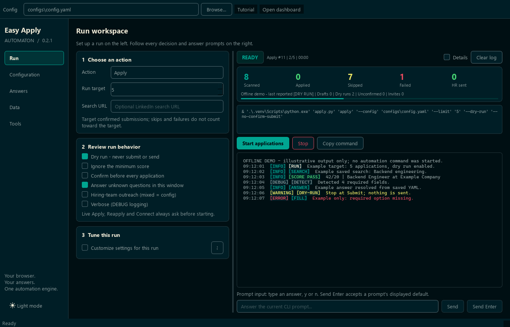
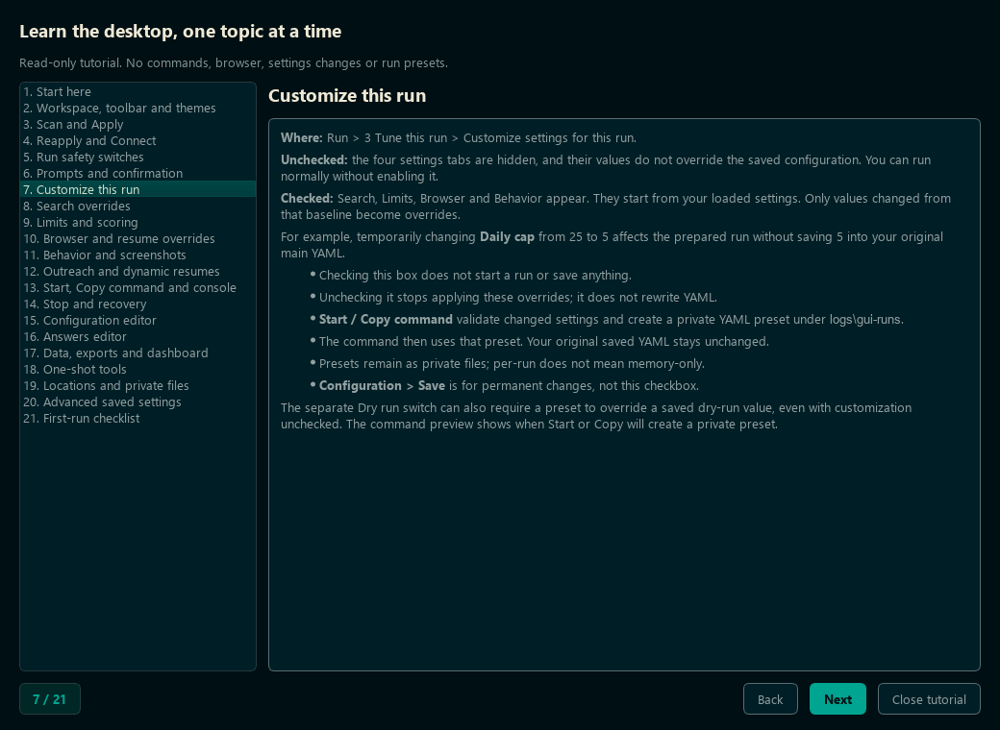
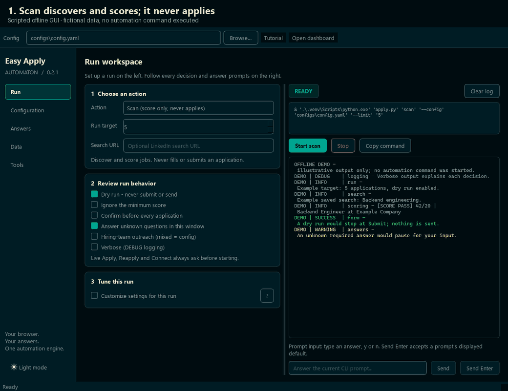

# Desktop GUI

A native window over the same automation the CLI drives. Buttons build a CLI
command, echo it into the log, and run it: `apply.py` in a source installation,
or the sibling `lea.exe` in the portable distribution. Common run settings have
dedicated controls; the YAML editor retains access to the full configuration.
For the commands themselves see
[Setup & Commands](setup-and-commands.md).



*Run setup and private per-run overrides on the left; a wrapped, live console
and interactive prompt input on the right. These source-generated v0.2.1
previews use isolated fictional data, not live applications.*

> 📸 Screenshots and scripted walkthrough GIFs are generated by
> `.\.venv\Scripts\python.exe tools\capture_screenshots.py` using the `.[dev,gui]`
> environment (Pillow is a development-only GIF encoder). It registers system
> fonts when Qt's font database is empty (headless Qt can report none, and every
> glyph would silently render as an empty box) and refuses to write anything
> until its tofu self-test passes. Captures use owned widgets, temporary INI
> preferences and fictional configuration/paths; they never press Start, Copy
> command or Save. GIF captions sit outside the rendered application.

```powershell
.\.venv\Scripts\python.exe -m pip install -e ".[gui]"
.\.venv\Scripts\python.exe apply.py gui
```

## Guided tutorial

Click **Tutorial**, press **F1**, or use **?** beside the per-run customization
checkbox. The read-only dialog covers every page/control with a topic list,
Back/Next, progress and Close/Finish. Navigation leaves current settings,
unsaved editor text and console input untouched. Help is disabled while a
command runs so it cannot obscure a live prompt.

To open only the guide, without configuration, history or browser startup:

```powershell
.\.venv\Scripts\python.exe apply.py gui --tutorial
```

It reads the same public [tutorial Markdown](gui-tutorial.md) used in the
dialog; links do not launch URLs. Windows v0.2.1 includes the same guide:

```powershell
.\EasyApplyAutomaton.exe --tutorial
.\lea.exe gui --tutorial
```

These standalone entries do not initialize a workspace. Older v0.2.0 EXEs
remain unchanged and do not support the tutorial flags.



*Contextual help explains the unchecked default, changed-only overrides and
private preset files. No command or setting change is performed by the tour.*

## Windows executable

Download the Windows x64 ZIP from
[Releases](https://github.com/Zanark/LinkedIn-EasyApply-Automaton/releases/latest).
Extract the **entire folder**, then double-click `EasyApplyAutomaton.exe`.
Keep `lea.exe` and `_internal` beside it; the small EXE alone is not the app.
Python does not need to be installed. An installed Edge or Chrome is required
for automation; browser binaries are not bundled.

The first launch creates example config/answers under
`%LOCALAPPDATA%\EasyApplyAutomaton`. Open **Tools → Locations → Workspace** to
find them, enter your own answers, add your PDFs under `generated\resume`,
and use **Tools → Sign in** before a scan and dry run. Existing source configs,
resumes and browser sessions are **not migrated automatically**.

Set `LEA_WORKSPACE` before launching either EXE to use a different writable
workspace. Subsequent launches never replace existing config files. The app
does not write private data into the extracted distribution. Updates can
therefore replace the distribution without replacing your workspace.

The portable build includes CSV/XLSX export, not Streamlit or OpenAI. Dynamic
resume building needs a separately installed builder and an explicit external
Python interpreter; otherwise static resume selection is used. Use the source
extras for the dashboard or AI advisor. The executables are unsigned; Windows
may show a SmartScreen warning. No fresh-machine or live-application
qualification is implied by an offline package smoke check.

## Reuse an existing setup

There is no need to initialize again when the source checkout already works.
From that checkout's root, use its existing environment:

```powershell
$env:LEA_WORKSPACE = (Get-Location).Path
.\.venv\Scripts\python.exe apply.py gui
```

This reuses the configured answers, resume files, database and browser profile,
including recorded history and learned answers. An expired LinkedIn session
may still require manual sign-in. Do not run two automation browsers against
the same profile simultaneously.

To use the packaged EXE instead, set `LEA_WORKSPACE` to that same checkout
before launching it:

```powershell
$env:LEA_WORKSPACE = 'C:\path\to\existing-checkout'
& 'C:\path\to\extracted-release\EasyApplyAutomaton.exe'
```

Relative configuration paths are resolved from that workspace, not from the
YAML file's directory. Keep an enabled dynamic builder's external Python
configured; preserving the old files does not add Streamlit/OpenAI to the EXE.
The source GUI retains the extras already installed in its environment.

Any manually collected machine-local bundle belongs under the ignored
`private-setup` directory. Keep private answers, resume inputs and database
backups out of commits, release assets and public attachments. A configuration
snapshot is not a standalone migration or an export of browser authentication.

## GUI options

Options:

| Flag | Meaning |
| --- | --- |
| `--config`, `-c` | Config file handed to every command it runs (default `configs/config.yaml`). |
| `--theme` | `deepseafoam` (dark) or `harbor-daylight` (light). Omit to reuse the last one. |
| `--tutorial` | Source and Windows v0.2.1: open only the offline guide, ignoring Config and leaving workspace data untouched. |

Without PySide6 installed, `apply.py gui` prints an install hint and exits `2`.
The rest of the CLI is unaffected — the Qt dependency is optional and imported
lazily.

## The five pages

**Run** — choose Scan, Apply, Reapply or Connect and set the target. For Apply,
the target counts confirmed submissions, not skipped or failed jobs. Reapply
also offers **List retry targets only**, and Connect can restrict drafts to a
run ID. The command preview updates as controls change.

**Customize settings for this run** exposes four tabs:

| Tab | Settings |
| --- | --- |
| Search | Enable saved searches; supply exact job URLs for Apply. |
| Limits | Company/daily caps, search pages/page size, pauses, score threshold. |
| Browser | Edge/Chrome/Chromium, profile, headless, timing, resume folder/default PDF. |
| Behavior | Unknown-question pauses, resume review delay, screenshots/cleanup, outreach mode and connection caps, dynamic builder enablement. |

Unchecked hides the tabs and applies no customization overrides; checking alone
does not save or start anything. Only changed overrides are applied.
**Start** and **Copy command** validate and
materialize a private preset in `logs\gui-runs`; the original YAML is unchanged.
Presets may contain personal configuration: keep them private like logs.
Save persistent changes through Configuration instead.
The separate Dry run switch can require a preset even when customization is
unchecked. The preview does not create a preset.



*Scan, dry-run Apply, changed-only customization, retry listing and connection
run filters, without executing a command. The README's static settings gallery
is an alternative to animation.*

The log wraps long lines and shows prompts even without a newline. Type an
answer or `y`/`n` in the input row and press **Send**; **Send Enter** accepts the
displayed default, including reading a field you filled manually in the browser.
**Confirm before every application** enables per-submit approval. Turning off
**Answer unknown questions in this window** adds `--yes` unless per-submit
confirmation takes precedence; unresolved answers are not invented.
Per-submit approval defaults to **Yes**, so Send Enter can submit. The initial
live-action warning defaults to **No**. Connect dry run still opens a browser,
whereas Reapply list-only does not.

**Stop is forceful cancellation**, not the CLI's graceful Ctrl+C: it terminates
the child, escalating to a kill after four seconds. Cleanup and a final summary
are not guaranteed; browser descendants may remain open. After interruption
near Submit, check LinkedIn and the recorded status before retrying.
**Copy command** copies a PowerShell command with safely quoted arguments.

Guards worth knowing:

- Live **Apply**, **Reapply** and **Connect** ask before starting. Dry run starts
  enabled; review it deliberately before sending anything.
- Per-submit approval and unknown-question prompting are separate controls.
- Flags that an action does not support are disabled rather than silently
  dropped — `--url` is greyed out for Reapply, `--ignore-score` for Scan, and so
  on.
- The hiring-team outreach checkbox is tri-state: partially checked means "use
  the `outreach.enabled` config value" rather than forcing either flag.

**Configuration** — edit `config.yaml` in place. **Validate** parses the YAML
*and* runs it through the same `AppConfig` model the CLI loads, so a bad value is
caught here instead of halfway through a run. Save refuses to write a file that
does not validate.

**Answers** — the same editor for your answers file, whose path is read from
`answers.file` in the config. Validation here is YAML-syntax only; content
quality is what **Run sync-answers** checks (it runs the CLI command and shows
the report in the Run log).

**Data** — a live snapshot of the database `stats()`, an export button
(CSV/XLSX), and the dashboard launcher.

**Tools** — one-shot commands: sign in, verify the browser session, scaffold
configs, preview a résumé choice (with an optional description), recognise a
question, and test the browser against an optional URL. Also a list of the
runtime directories (logs, screenshots, generated résumés, outreach reports,
search diagnostics) with buttons to open them in Explorer.

## Dashboard from either side

In a source installation, the Streamlit dashboard stays a separate, read-only analytics surface. Open it
whichever way suits you:

```powershell
.\.venv\Scripts\python.exe apply.py dashboard     # from the CLI
```

or from the GUI's **Data → Open dashboard** button (also <kbd>Ctrl</kbd>+<kbd>D</kbd>
from anywhere in the window). The GUI starts it as a *detached* process and opens
`http://localhost:8501`, so it keeps running even if you close the window;
pressing the button again just reopens the browser tab. It needs the dashboard
extra (`pip install .[dashboard]`).

## Themes

Both themes come from the [DeepSeaFoam](https://github.com/Zanark/DeepSeaFoam)
project and are transcribed in `linkedin_easy_apply/gui/theme.py` as *semantic
roles*, not copied field names, per that project's porting rules.

| | DeepSeaFoam (dark) | Harbor Daylight (light) |
| --- | --- | --- |
| Ambient field | `#000F13` base | `#F3F2E9` background |
| Panels | `#001E26` panel | `#E3ECE7` surface |
| Raised / inputs | `#001E26` (no third dark surface exists) | `#FCFAF2` paper |
| Reading ink | `#93A1A1` | `#355451` |
| Lower emphasis | `#839496` faintText | `#536B66` muted |
| Headings | `#EEE8D5` warm | `#173D3A` heading |
| Accent | `#00A591` | `#006F63` |
| Primary-action hover | `#93A1A1` (text's documented second role) | `#00594F` accentHover |
| Status | `#45D072` / `#EBE565` / `#E84A5F` | `#247449` / `#77600E` / `#AD3E55` |

Switch with the button at the bottom of the sidebar; the choice is remembered
through `QSettings`.

Two porting details the code handles deliberately:

- **Alpha position.** The palettes publish translucent tokens as CSS
  `#RRGGBBAA` (alpha last), but Qt reads 8-digit hex as `#AARRGGBB` (alpha
  first). `theme.qt_color()` converts every such token to `rgba(r, g, b, a)`;
  a test asserts no 8-digit hex survives into the generated stylesheet.
- **Roles are not interchangeable.** DeepSeaFoam has no second accent fill — its
  `text` role is documented as "primary text *and primary-action hover*", so
  that is what the dark theme's hovered primary button uses, with the near-black
  base as the ink on top. Harbor Daylight has a real `accentHover` solid and
  uses paper as button ink.

This is an application of the published palettes, not a native DeepSeaFoam
target or a contrast certification. Harbor Daylight's documented contrast
figures cover its own specified pairs; they are not a blanket guarantee for
every composite rendered here.

## Module layout

| Module | Qt? | Purpose |
| --- | --- | --- |
| `gui/theme.py` | no | Palettes, colour conversion, QSS builder. |
| `gui/commands.py` | no | Argv builders shared with the CLI. |
| `gui/process.py` | yes | `QProcess` wrapper: live output, stop, detached launch. |
| `gui/widgets.py` | yes | Card, level-coloured console, path rows. |
| `gui/settings.py` | no | Validated private run presets without changing saved YAML. |
| `gui/settings_panel.py` | yes | Search, Limits, Browser and Behavior controls. |
| `gui/tutorial.py` | yes | Read-only topic navigation from the canonical public Markdown guide. |
| `gui/main_window.py` | yes | The window and its five pages. |
| `runtime.py` | no | Source/frozen resources, writable workspace and first-launch examples. |

Qt-free command, theme, preset and runtime tests also run without PySide6.
Window, console and process tests use Qt's offscreen platform. Packaging adds
an offline smoke of both frozen executables, exports, the Playwright driver
and a real sibling-CLI child process; it never opens LinkedIn.
