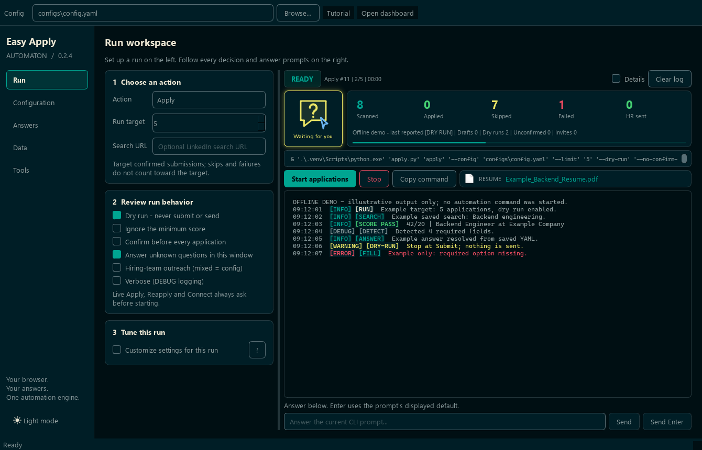
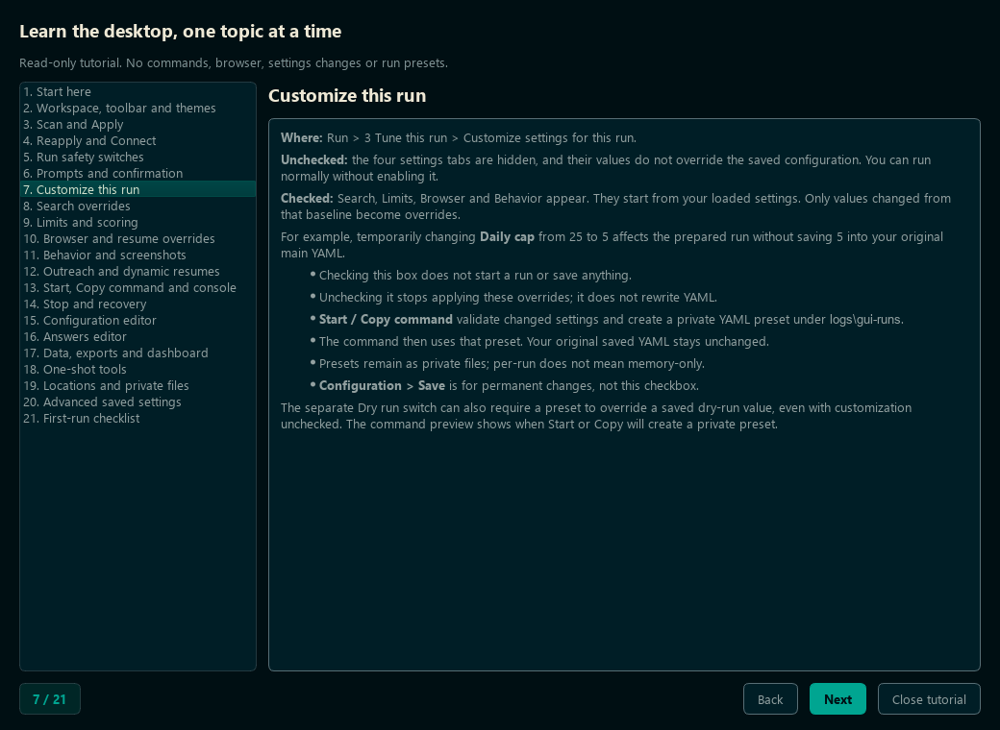
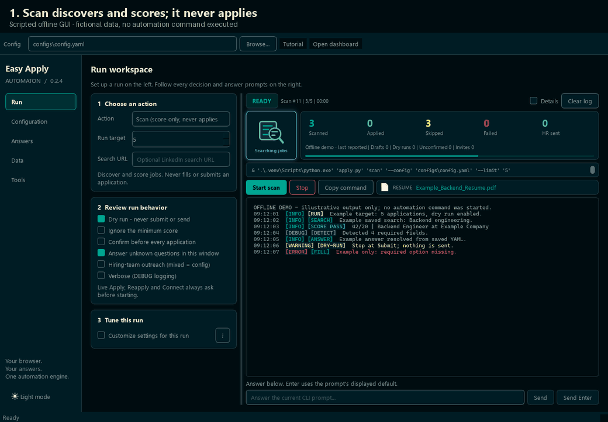

# Desktop GUI

A native window over the same automation the CLI drives. Buttons build a CLI
command, echo it into the log, and run it: `apply.py` in a source installation,
or the sibling `lea.exe` in the portable distribution. Common run settings have
dedicated controls; the YAML editor retains access to the full configuration.
For the commands themselves see
[Setup & Commands](../getting-started/setup-and-commands.md).



*Current source layout: run setup on the left; larger current-action icon, outcome
counters, retained resume filename, console and prompt input on the right.
These current previews use isolated fictional data, not live applications.*

> 📸 Screenshots and scripted walkthrough GIFs are generated by
> `.\.venv\Scripts\python.exe tools\media\capture_screenshots.py` using the `.[dev,gui]`
> environment (Pillow is a development-only GIF encoder). It registers system
> fonts when Qt's font database is empty (headless Qt can report none, and every
> glyph would silently render as an empty box) and refuses to write anything
> until its tofu self-test passes. Captures use owned widgets, temporary INI
> preferences and fictional configuration/paths; they never press Start, Copy
> command or Save. GIF captions sit outside the rendered application. The Limits
> still includes the actual native tooltip, composed from owned widget grabs,
> never a shared-desktop capture.

```powershell
.\.venv\Scripts\python.exe -m pip install -e ".[gui]"
.\.venv\Scripts\python.exe apply.py gui
```

## Guided tutorial

Click **Tutorial**, press **F1**, or use **?** beside the per-run customization
checkbox. The read-only dialog covers every page/control with a topic list,
Back/Next, progress and Close/Finish. Navigation leaves current settings,
unsaved editor text and console input untouched. The tutorial is disabled while a
command runs so it cannot obscure a live prompt.

**Toolbar (v0.2.2 and source):** right-clicking Tutorial or the toolbar no longer
offers the native **Main** visibility checkbox. The essential controls stay
visible; text fields keep their editing menus. For an older hidden toolbar,
[finish the run, save edits and reopen](troubleshooting.md#the-top-toolbar-disappeared).
No configuration or preference reset is needed; older v0.2.1 EXEs are unchanged.

**Hover help (v0.2.2 and source):** pause over a field, toggle, button or its label
for two logical lines: what it does, then **Example:** with a practical use.
Tabs, saved-search entries and dropdown choices also explain themselves.
Action-dependent targets and tool inputs update their explanations when their
meaning changes. Disabled fields still explain their purpose. These small,
nonmodal popups do not save settings or start commands; the console retains
its separate per-message diagnostic hover text. Reopen the updated source GUI
or use the newly extracted v0.2.5 EXE; older v0.2.1 EXEs do not gain this update.

To open only the guide, without configuration, history or browser startup:

```powershell
.\.venv\Scripts\python.exe apply.py gui --tutorial
```

It reads the same public [tutorial Markdown](gui-tutorial.md) used in the
dialog; links do not launch URLs. See the
[offline tutorial walkthrough GIF](../assets/images/gui-tutorial-walkthrough.gif).
Windows v0.2.1 and later also include a bundled tutorial:

```powershell
.\EasyApplyAutomaton.exe --tutorial
.\lea.exe gui --tutorial
```

These standalone entries do not initialize a workspace. Older v0.2.0 EXEs
remain unchanged and do not support the tutorial flags.



*Contextual help explains the unchecked default, changed-only overrides and
private preset files. No command or setting change is performed by the tour.*

## Windows executable

**Windows v0.2.4 branding:** desktop windows use the project's
seafoam form-and-lightning mark rather than interpreter branding. The same
multi-resolution `docs/assets/branding/mark.ico` is embedded in both Windows executables and
bundled for Qt; the original `docs/assets/branding/mark.svg` remains the artwork source.
A stable, version-independent Windows application identity is set before Qt
startup without changing saved preferences. Tutorial and startup-error windows
use the same setup. Existing downloads and already-running windows are unchanged.
Reopen an updated app only after finishing commands and saving editor changes.
An older pinned shortcut can retain its original icon; pin the updated executable
instead. No interpreter modification, shell-cache clearing or automatic repinning
is performed.

Download the Windows x64 ZIP from
[Releases](https://github.com/Zanark/LinkedIn-EasyApply-Automaton/releases/latest).
Extract the **entire folder**, then double-click `EasyApplyAutomaton.exe`.
Keep `lea.exe` and `_internal` beside it; the small EXE alone is not the app.
Python does not need to be installed. An installed Edge or Chrome is required
for automation; browser binaries are not bundled.

The first launch creates example config/answers under
`%LOCALAPPDATA%\EasyApplyAutomaton`. Open **Tools → Locations → Workspace** to
find them, enter your own answers, add your PDFs under `generated\resume`,
and use **Tools → Sign in** before a scan and dry run. Existing source configs,
resumes and browser sessions are **not migrated automatically**.

Set `LEA_WORKSPACE` before launching either EXE to use a different writable
workspace. Subsequent launches never replace existing config files. The app
does not write private data into the extracted distribution. Updates can
therefore replace the distribution without replacing your workspace.

The portable build includes CSV/XLSX export, not Streamlit or OpenAI. Dynamic
resume building needs a separately installed builder and an explicit external
Python interpreter; otherwise static resume selection is used. Use the source
extras for the dashboard or AI advisor. The executables are unsigned; Windows
may show a SmartScreen warning. No fresh-machine or live-application
qualification is implied by an offline package smoke check.

## Reuse an existing setup

There is no need to initialize again when the source checkout already works.
From that checkout's root, use its existing environment:

```powershell
$env:LEA_WORKSPACE = (Get-Location).Path
.\.venv\Scripts\python.exe apply.py gui
```

This reuses the configured answers, resume files, database and browser profile,
including recorded history and learned answers. An expired LinkedIn session
may still require manual sign-in. Do not run two automation browsers against
the same profile simultaneously.

To use the packaged EXE instead, set `LEA_WORKSPACE` to that same checkout
before launching it:

```powershell
$env:LEA_WORKSPACE = 'C:\path\to\existing-checkout'
& 'C:\path\to\extracted-release\EasyApplyAutomaton.exe'
```

Relative configuration paths are resolved from that workspace, not from the
YAML file's directory. Keep an enabled dynamic builder's external Python
configured; preserving the old files does not add Streamlit/OpenAI to the EXE.
The source GUI retains the extras already installed in its environment.

An existing `private-setup\Start-SourceSetup.cmd` directly launches this source
checkout with its existing environment and configuration. It does not fetch or
choose a GitHub release. The same command therefore loads updated source on
the next launch, while a separately extracted EXE runs its own packaged build.
Finish any active run and save unsaved edits before reopening either GUI.
No configuration reset or repeat initialization is required.

Any manually collected machine-local bundle belongs under the ignored
`private-setup` directory. Keep private answers, resume inputs and database
backups out of commits, release assets and public attachments. A configuration
snapshot is not a standalone migration or an export of browser authentication.

## GUI options

Options:

| Flag | Meaning |
| --- | --- |
| `--config`, `-c` | Config file handed to every command it runs (default `configs/config.yaml`). |
| `--theme` | `deepseafoam` (dark) or `harbor-daylight` (light). Omit to reuse the last one. |
| `--tutorial` | Source and Windows v0.2.1 or later: open only the offline guide, ignoring Config and leaving workspace data untouched. |

Without PySide6 installed, `apply.py gui` prints an install hint and exits `2`.
The rest of the CLI is unaffected — the Qt dependency is optional and imported
lazily.

## The five pages

**Run** — choose Scan, Apply, Reapply or Connect and set the target. For Apply,
the target counts confirmed submissions, not skipped or failed jobs. Reapply
also offers **List retry targets only**, and Connect can restrict drafts to a
run ID. The command preview updates as controls change.

**Customize settings for this run** exposes four tabs:

| Tab | Settings |
| --- | --- |
| Search | Enable saved searches; supply exact job URLs for Apply. |
| Limits | Company/daily caps, search pages/page size, pauses, score threshold. |
| Browser | Edge/Chrome/Chromium, profile, headless, timing, resume folder/default PDF. |
| Behavior | Unknown-question pauses, resume review delay, screenshots/cleanup, outreach mode, connection caps and optional no-note fallback, dynamic builder enablement. |

Unchecked hides the tabs and applies no customization overrides; checking alone
does not save or start anything. Only changed overrides are applied.
**Connect without a note if unavailable** defaults off and applies to standalone
Connect and the optional end-of-run invitation pass. Enabled still prefers the
note; only unavailable note entry permits a plain invitation. Source and Windows v0.2.5
wait for controls and recognize explicit no-note actions or a final Send/Connect
inside an identified invitation dialog, never an unrelated message Send.
Dry run skips all final send actions. A confirmed plain invitation is
counted under Invites, not HR sent, and does not mark its draft note as delivered.
This control is included in source and Windows v0.2.4; older v0.2.3 EXEs are
unchanged. The control-recognition repair ships in v0.2.5; v0.2.4 retains its
older exact-only fallback. A final click alone is not delivery confirmation.
**Start** and **Copy command** validate and
materialize a private preset in `logs\gui-runs`; the original YAML is unchanged.
Presets may contain personal configuration: keep them private like logs.
Save persistent changes through Configuration instead.
The separate Dry run switch can require a preset even when customization is
unchecked. The preview does not create a preset.



*Scan, dry-run Apply, changed-only customization, retry listing and connection
run filters, with fictional action icons, changing/retained resume filenames and
outcome counters, without executing a command. The
[README's Limits screenshot](../../README.md#screenshots) is a still-image alternative.*

### Current action and last resume (source and Windows v0.2.4)

The **Current action** tile beside the counters shows an icon above the actual
operation name: searching jobs, selecting/building a resume, filling a form,
uploading, checking submission, drafting/sending outreach or processing an
invitation. **Waiting for you** is an input/approval pause, not a stalled run.
Command start, completion, Stop, errors and unavailable status stay distinct.
Tools without operation updates show their command lifecycle instead.

Every operation and lifecycle state has its own original outlined artwork with
internal detail, partial fills and multicolor accents. Blue signals normal work,
green/teal resume or completion work, yellow pause/caution, and red error/discard.
The icon/name group is centered with padding; the action name is 23% smaller
and uses the bundled, rounded Nunito font. A soft, steady border glow follows
the current stage's color in both themes; it does not flash or pulse.
The redundant visible **CURRENT ACTION** header is gone. Color and icons
describe an operation, never proof that an application or invitation succeeded.

**Larger icons in source and Windows v0.2.5:** all 36 icons render at 64-by-64 logical pixels,
up from 40-by-40 (2.56 times the area). The tile stays 112 by 108 pixels; tighter
internal spacing preserves the full centered labels and their existing font.
The immutable Windows v0.2.4 download retains its original 40px icons.

See the [complete action icon glossary](gui-action-icons.md) for all **36
actual icons**, their displayed names, meanings, state IDs and color/glow
legend. The [README](../../README.md#action-icon-glossary) keeps a compact,
expandable icon gallery and links here for the explanations.

The **Resume** field beside Start/Stop/Copy command shows the final filename
chosen for an application, including a tailored PDF that replaced a static
choice. It wraps below the buttons in a narrow window; long filenames shorten
in the middle, with the full filename available on hover.

That filename stays until another application chooses a resume. Missing
choices, scan-only previews, tools, later runs, Clear log and theme changes do
not erase it. Retention lasts only while this GUI window is open; it is not
saved to preferences. **Selection is not proof of upload or submission.**
Use the console and confirmed-outcome counters for those results.

The indicators first shipped in v0.2.3; v0.2.4 adds the detailed artwork and
centered rounded labels and stage-colored border glow. Older immutable downloads are unchanged.
The source launcher loads updated source on your next
deliberate launch; finish any active command and save edits before reopening.
No configuration reset is needed. Each indicator has purpose/example hover help.

### Live run counters (current source)

Available in source and Windows v0.2.2. The strip above the console updates
while a GUI-started command runs, including
while an approval prompt waits. It describes **this command**, not database
lifetime totals or another running window.

| Apply / Scan / Reapply card | Meaning |
| --- | --- |
| Scanned | Jobs inspected; repeated discovery results count once. |
| Applied | Workflow-confirmed submissions, never mere Submit clicks. |
| Skipped | Skip decisions, including scan-only jobs and completed dry runs, matching the summary. |
| Failed | Failed applications; uncertain submissions are separate. |
| HR sent | Hiring-team messages reported sent by the engine, not drafts or connection invitations. |

The footer separates **Drafts**, **Dry runs**, **Unconfirmed** and **Invites**;
other outreach and invitation outcomes appear when relevant. Standalone Connect
uses **Profiles / Invites / Already / Skipped / Failed**, with dry-run
**Would-send** separate. An attached connection pass keeps the job totals and
switches target progress to profiles checked.

The header identifies the actual child action/run, target fraction and elapsed
process time, not an ETA. Scan advances toward jobs inspected; Apply/Reapply
advance toward confirmed applications plus completed dry-run forms. A command
ending early does not fill the target bar. Before the first valid snapshot,
`--` means unavailable, not zero.

Counts survive completion, Stop, theme changes, selector edits and Clear log.
They reset only when another command is accepted. Retry list-only uses the
historical cards below; unsupported tools hide the strip.
A broken stream keeps the last good values with a warning.
Elapsed time freezes when the child ends. **Finished - last reported** does not
mean every target succeeded.

Snapshots are not a durable transaction ledger. A hard stop after an action but
before database persistence can leave counts ahead of history or the final
summary; verify LinkedIn before retrying. Older v0.2.1 EXEs do not include
these counters. Finish an active run and save edits before reopening the updated
source GUI or the newly extracted v0.2.5 EXE.

### Retry preview (current source)

Available in source and Windows v0.2.5.

**Reapply → List retry targets only (no browser)** keeps the same layout:
the action tile on the left and five numeric cards on the right. It reports
the exact saved batch printed in the console, not new run outcomes.

| Preview card | Saved-history meaning |
| --- | --- |
| Targets | Distinct eligible jobs in this batch. |
| Failed | Targets whose latest failed/aborted attempt was failed. |
| Aborted | Targets whose latest failed/aborted attempt was aborted. |
| Attempts | Total failed/aborted attempts across these targets. |
| Repeated | Targets with more than one failed/aborted attempt. |

Failed plus Aborted equals Targets; repeated jobs count once in Repeated.
For example, four targets can have seven attempts and two repeated jobs.
The database query returns at most 200 eligible jobs, excludes any submitted
or unconfirmed application, and requires a usable saved URL. These are batch
counts, not totals for the whole database.

The strip says **Retry preview** and **No browser or sends**; no submission
progress bar is shown. An empty successful query reports five zeroes; before
a valid response, unavailable values stay `--`. Values remain after completion,
theme/selector changes and Clear log. Checking list-only affects only Reapply.
Older immutable downloads, including v0.2.4, are unchanged.

With list-only **off**, Reapply still uses the normal application pipeline:
**Scanned / Applied / Skipped / Failed / HR sent**. Confirmed retries can draft
or send hiring-team messages according to configured mode and approval; the
footer separates Drafts, HR declined/failed/would-send and invitation outcomes.
An application failure, an outreach failure and an uncertain submission are
different results. A retry URL that cannot be opened counts as a skip, not a
failed application. Preview cannot create these live outcomes.

### Console and prompts

The source and Windows v0.2.2 console wraps at word boundaries, with short timestamps,
colored severity badges and activity labels such as **SEARCH**, **DETECT**,
**ANSWER**, **FILL**, **RESUME** and **INPUT**. Green **SCORE PASS** and
**SUBMITTED** mark positive decisions and confirmed submissions; amber
**SCORE FAIL**, **SKIP**, **WAIT** and **DRY-RUN** are not execution failures.
Red severity badges/messages identify errors. **SUBMIT** means an attempt,
not confirmation; **DONE** means a successful child exit, not an application.
Stopped children show **STOPPED**, not a green completion message.

Toggle **Details** beside Clear log for the original dates and
`module:function:line` prefixes; compact entries also expose them on hover.
This only changes presentation: file logs, CLI output and configuration stay
unchanged. History retains up to 5,000 lines, including across theme/Details
changes. New output follows the tail only while you are already at the bottom.
Unrecognized output, traceback indentation and prompts without a newline are
preserved. Older v0.2.1 downloads do not contain this update.

Type an answer or `y`/`n` in the input row and press **Send**; **Send Enter** accepts the
displayed default, including reading a field you filled manually in the browser.
**Confirm before every application** enables per-submit approval. Turning off
**Answer unknown questions in this window** adds `--yes` unless per-submit
confirmation takes precedence; unresolved answers are not invented.
Per-submit approval defaults to **Yes**, so Send Enter can submit. The initial
live-action warning defaults to **No**. Connect dry run still opens a browser,
whereas Reapply list-only does not.

**Stop is forceful cancellation**, not the CLI's graceful Ctrl+C: it terminates
the child, escalating to a kill after four seconds. Cleanup and a final summary
are not guaranteed; browser descendants may remain open. After interruption
near Submit, check LinkedIn and the recorded status before retrying.
**Copy command** copies a PowerShell command with safely quoted arguments.

Guards worth knowing:

- Live **Apply**, **Reapply** and **Connect** ask before starting. Dry run starts
  enabled; review it deliberately before sending anything.
- Per-submit approval and unknown-question prompting are separate controls.
- Flags that an action does not support are disabled rather than silently
  dropped — `--url` is greyed out for Reapply, `--ignore-score` for Scan, and so
  on.
- The hiring-team outreach checkbox is tri-state: partially checked means "use
  the `outreach.enabled` config value" rather than forcing either flag.

**Configuration** — edit `config.yaml` in place. **Validate** parses the YAML
*and* runs it through the same `AppConfig` model the CLI loads, so a bad value is
caught here instead of halfway through a run. Save refuses to write a file that
does not validate.

**Answers** — the same editor for your answers file, whose path is read from
`answers.file` in the config. Validation here is YAML-syntax only; content
quality is what **Run sync-answers** checks (it runs the CLI command and shows
the report in the Run log).

**Data** — a live snapshot of the database `stats()`, an export button
(CSV/XLSX), and the dashboard launcher.

**Tools** — one-shot commands: sign in, verify the browser session, scaffold
configs, preview a résumé choice (with an optional description), recognise a
question, and test the browser against an optional URL. Also a list of the
runtime directories (logs, screenshots, generated résumés, outreach reports,
search diagnostics) with buttons to open them in Explorer.

## Dashboard from either side

In a source installation, the Streamlit dashboard stays a separate, read-only analytics surface. Open it
whichever way suits you:

```powershell
.\.venv\Scripts\python.exe apply.py dashboard     # from the CLI
```

or from the GUI's **Data → Open dashboard** button (also <kbd>Ctrl</kbd>+<kbd>D</kbd>
from anywhere in the window). The GUI starts it as a *detached* process and opens
`http://localhost:8501`, so it keeps running even if you close the window;
pressing the button again just reopens the browser tab. It needs the dashboard
extra (`pip install .[dashboard]`).

## Themes

Both themes come from the [DeepSeaFoam](https://github.com/Zanark/DeepSeaFoam)
project and are transcribed in `linkedin_easy_apply/gui/theme.py` as *semantic
roles*, not copied field names, per that project's porting rules.

| | DeepSeaFoam (dark) | Harbor Daylight (light) |
| --- | --- | --- |
| Ambient field | `#000F13` base | `#F3F2E9` background |
| Panels | `#001E26` panel | `#E3ECE7` surface |
| Raised / inputs | `#001E26` (no third dark surface exists) | `#FCFAF2` paper |
| Reading ink | `#93A1A1` | `#355451` |
| Lower emphasis | `#839496` faintText | `#536B66` muted |
| Headings | `#EEE8D5` warm | `#173D3A` heading |
| Accent | `#00A591` | `#006F63` |
| Primary-action hover | `#93A1A1` (text's documented second role) | `#00594F` accentHover |
| Status | `#45D072` / `#EBE565` / `#E84A5F` | `#247449` / `#77600E` / `#AD3E55` |

Switch with the button at the bottom of the sidebar; the choice is remembered
through `QSettings`.

Two porting details the code handles deliberately:

- **Alpha position.** The palettes publish translucent tokens as CSS
  `#RRGGBBAA` (alpha last), but Qt reads 8-digit hex as `#AARRGGBB` (alpha
  first). `theme.qt_color()` converts every such token to `rgba(r, g, b, a)`;
  a test asserts no 8-digit hex survives into the generated stylesheet.
- **Roles are not interchangeable.** DeepSeaFoam has no second accent fill — its
  `text` role is documented as "primary text *and primary-action hover*", so
  that is what the dark theme's hovered primary button uses, with the near-black
  base as the ink on top. Harbor Daylight has a real `accentHover` solid and
  uses paper as button ink.

This is an application of the published palettes, not a native DeepSeaFoam
target or a contrast certification. Harbor Daylight's documented contrast
figures cover its own specified pairs; they are not a blanket guarantee for
every composite rendered here.

## Module layout

| Module | Qt? | Purpose |
| --- | --- | --- |
| `gui/theme.py` | no | Palettes, colour conversion, QSS builder. |
| `gui/commands.py` | no | Argv builders shared with the CLI. |
| `gui/process.py` | yes | `QProcess` wrapper: live output, stop, detached launch. |
| `progress.py` | no | Strict outcome snapshots, optional reporter and bounded stream framing. |
| `gui/metrics.py` | yes | Responsive outcome cards, target progress and elapsed process time. |
| `gui/widgets.py` | yes | Card, level-coloured console, path rows. |
| `gui/settings.py` | no | Validated private run presets without changing saved YAML. |
| `gui/settings_panel.py` | yes | Search, Limits, Browser and Behavior controls. |
| `gui/tutorial.py` | yes | Read-only topic navigation from the canonical public Markdown guide. |
| `gui/main_window.py` | yes | The window and its five pages. |
| `runtime.py` | no | Source/frozen resources, writable workspace and first-launch examples. |

Qt-free command, theme, preset and runtime tests also run without PySide6.
Window, console and process tests use Qt's offscreen platform. Packaging adds
an offline smoke of both frozen executables, exports, the Playwright driver
and a real sibling-CLI child process; it never opens LinkedIn.
