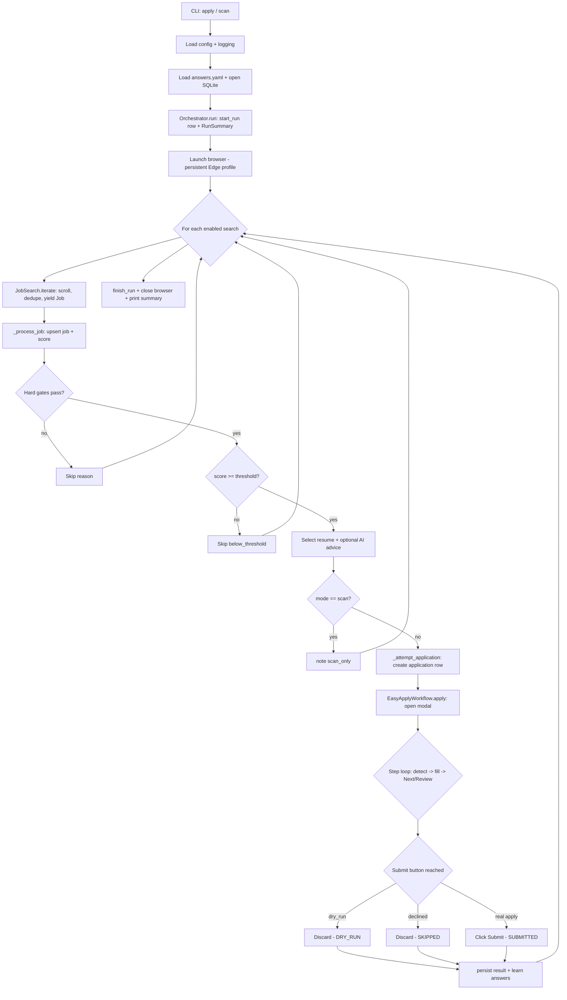

# Run lifecycle — what happens from start to finish

> A stage-by-stage walkthrough of one run: where it starts, how a job is
> discovered, what happens when a job is found, how the form is filled, and how
> it ends. Every stage points at the **real function** that does the work and the
> **log line** you'll see. For the diagrams and the "why", see
> [`architecture.md`](architecture.md); for the design of each piece, see
> [`data-structures.md`](data-structures.md) and [`algorithms.md`](algorithms.md).

## The whole run at a glance



---

## Phase 0 — Startup (kahaan se shuru hota hai)

You run one command, e.g. a safe test run:

```powershell
.\.venv\Scripts\python.exe apply.py -v apply --dry-run -y
```

The CLI (`cli/main.py`) prepares everything before any browser opens:

1. **`_load()`** reads `configs/config.yaml`, validates it through the Pydantic
   models, and calls **`setup_logging()`** — the console + rotating file sinks
   start here. With `-v`, the level is forced to `DEBUG`.
2. **`_answer_store()`** loads `configs/answers.yaml` into an `AnswerStore` (your
   personal data: experience, skills, contact, booleans).
3. **`_database()`** opens the SQLite file and runs `initialize()` (creates the
   schema on first use).
4. **`_run_orchestrator()`** wires the interactive callbacks based on your flags
   (`on_unknown` to ask about unrecognised questions — on unless `--yes`;
   `on_confirm` to confirm a submit — **only** with `--confirm-submit`, and its
   prompt defaults to Yes), constructs the `Orchestrator`, and calls
   `orchestrator.run(...)`.

---

## Phase 1 — Run setup (`Orchestrator.run`)

5. Resolve the effective flags (`dry_run`, `interactive`, `max_per_run`) from the
   arguments, falling back to config.
6. Read `search.enabled_searches`; if none are enabled it raises immediately.
7. **`db.start_run(...)`** inserts a row in the `runs` table and returns a
   `run_id`; a `RunSummary` counter object is created.
8. Enter the browser context manager: **`with BrowserManager(...) as browser:`**
   launches Edge (or Chrome/Chromium) using your **persistent profile** so your
   existing LinkedIn login is reused — the tool never handles your password.

```
INFO  orchestrator:run - Run starting: mode=dry_run dry_run=True interactive=False max_per_run=… | 2 enabled search(es): ['software-engineer', 'full-stack-developer']
INFO  browser.manager:start - Launching edge (headless=False) with profile .browser-profile
```

---

## Phase 2 — Discovery (`_execute` → `JobSearch.iterate`)

9. Build a `JobSearch` driver and `WorkflowSettings`. Compute
   `scan_cap = max(max_per_run * 5, 30)` — an upper bound on how many jobs to
   look at per search.
10. **For each enabled search**, log `=== Search: <name> ===` and open the
    search URL.
11. **`JobSearch.iterate(...)` is a generator.** It scrolls the results list,
    collects job IDs into a **visited `set`** (no duplicates), and **stops
    scrolling after 3 scrolls that add nothing** (you've hit the bottom) or after
    a hard cap of 15 scrolls. It then **`yield`s one `Job` at a time**, each built
    by `JobExtractor` (title, company, description, easy-apply flag, …).

```
INFO  jobs.search:open    - Opening search https://www.linkedin.com/jobs/search/?keywords=software%20engineer&…
INFO  jobs.search:iterate - Collected 7 job id(s) from 'software-engineer'
```

Each yielded job increments `summary.scanned` and flows into `_process_job`. The
loop stops early when `summary.applied >= max_per_run` (except in scan mode) or
the daily limit is hit.

---

## Phase 3 — When a job is found (`_process_job`) — *jab job milta hai toh kya hota*

For **every** job, in order:

12. **`db.upsert_job(...)`** inserts/updates the `jobs` row (idempotent on URL)
    and returns `job_id`. Logs `Job: <title> @ <company> (<posted>)`.
13. **`gate = _pre_apply_checks(job)`** runs the hard filters (Easy-Apply?
    already applied? duplicate company+role? whitelist/blacklist? include/exclude
    keywords? per-company limit?).
14. **`score = _scoring.score(title, description)`** is computed and **always
    recorded** via `db.record_score(...)`, whether or not the job proceeds. The
    score gate also emits an INFO breadcrumb — `[SCORE PASS] N/T | …` or
    `[SCORE FAIL] N/T | …` — so the pass/fail column is greppable without
    turning on DEBUG.
15. **Decision:**
    - if a gate tripped → `Skip (<reason>)` and return;
    - else if `score < threshold` → `Skip (score N < T)` and return;
    - else continue.
16. **`_resume_selector.select(...)`** picks the best résumé (mapping → keyword
    overlap → default) and logs it at INFO — `Best resume for '<job>': '<file>'
    (<reason>)` — then, when actually applying, pauses `run.resume_review_pause`
    seconds (default 3) so the pick is readable in the live log before the form opens.
17. **`_advise(...)`** runs the optional AI advisor; if it says *no*, skip as
    `ai_advised_against` (no-op when AI is disabled).
18. If **`mode == "scan"`** → note `scan_only` and return — **scan never opens
    the application form** (and never renders a tailored résumé). Otherwise, if
    `resume.builder.enabled`, **`_tailor_resume(job)`** asks the standalone
    builder to render a résumé tailored to this job and, on a match, **overrides**
    the static pick from step 16 (else the static pick stands); then →
    `_attempt_application(...)`. See
    [*Dynamic résumé generation*](configuration.md#resumebuilder-dynamic-per-job-resumes).

```
INFO  orchestrator:_process_job - Job: Lead Back End Engineer @ HDFC Bank (1 day ago)
INFO  orchestrator:_process_job - [SCORE FAIL] 16/20 | Lead Back End Engineer @ HDFC Bank (1 day ago)
DEBUG orchestrator:_process_job - Scored 'Lead Back End Engineer': 16 vs threshold 20 -> FAIL (breakdown: {'sql': 8, 'backend': 8})
INFO  orchestrator:_process_job - Skip (score 16 < 20) - Lead Back End Engineer @ HDFC Bank (1 day ago)
INFO  orchestrator:_tailor_resume - Tailored resume 'Debashish_Mishra_ai.pdf' for 'Senior AI Engineer' (tailored: keyword cluster 'ai' (score 8))
```

(See [`configuration.md` → scoring](configuration.md#scoring) and
[FAQ → *Why was a job skipped?*](faq.md#why-was-a-job-skipped) for the full
gate + score logic.)

---

## Phase 4 — Application attempt (`_attempt_application`)

19. **`db.create_application(...)`** inserts an `applications` row with status
    `pending` and returns `application_id` (so a crash still leaves a record).
    Then **`_apply_expected_ctc_tier(job)`** infers the role's **seniority tier**
    from the title (default **SDE 1**) and hands the matching `expected_ctc_<tier>`
    (plus any `expected_ctc_monthly_<tier>`) to the resolver — logged at INFO, e.g.
    `Seniority tier for '<job>': SDE3 -> expected CTC 4000000 (40 LPA), monthly
    340000` — so the expected-salary answer scales with the level.
20. Render a cover letter for the job (`_maybe_cover_letter`): writes both a
    `.pdf` (the artefact upload fields expect) and a `.txt`, and returns the
    letter **text** too so inline cover-letter textareas can be auto-filled.
    Logged at INFO (`Generated cover letter for '<company>' -> <path>`).
21. Build an **`EasyApplyWorkflow`**, injecting the collaborators: parser,
    resolver, field detector, filler, screenshot manager, settings, and the
    unknown/confirm callbacks.
22. Call `workflow.apply(resume_path, cover_letter_path, cover_letter_text)`
    (Phase 5) — the PDF path feeds file-upload fields, the text feeds inline
    textareas. If it throws,
    log the error, mark the application `failed`, bump `summary.failed`, return.
    On success → `_persist_result(...)` (Phase 7).

---

## Phase 5 — The Easy Apply modal loop (`EasyApplyWorkflow.apply`) — the heart

23. **`_open_modal()`** finds and clicks the **Easy Apply** button. If it's
    missing (external application) or already says *Applied*, return `SKIPPED`.
    When the modal asks for a résumé, the workflow pehle on-page resume cards
    dekhta hai: matching filename mila toh select, missing hai toh PDF upload,
    and only if LinkedIn exposes no file input does it ask for manual help.
24. Then loop over steps (`for step in 1..max_steps`). Each step:
    - wait a beat, **capture a screenshot** `step-N.png`, log `--- Easy Apply step N ---`;
    - **`_fill_step()`** → **`FormFieldDetector.detect()`** finds every field in
      the current step, then for each field **`_fill_field()`** does the
      parse → resolve → fill pipeline:
      1. **parser** turns the label into a `QuestionCategory` (with a confidence),
      2. **resolver** looks up the value from `answers.yaml` (or learned answers),
      3. if it's an **unknown** question and prompting is on, **`_resolve_interactively()`**
         lets you either type in the terminal *or* fill LinkedIn directly and
         press Enter — jo value final hai, wahi DB mein save hoti hai as
         `manual` or `portal`,
      4. **filler** fills the text/select/radio; if the field already has the
         same value, it logs `already filled ... leaving as is` and skips the
         overwrite; otherwise it logs `filled with '…'` or `could not fill -
         left blank` (it never guesses a wrong option);
    - **`_detect_action()`** looks for the step's button → `submit` / `review` /
      `next` / `none`;
    - on **`next`/`review`**: record a "signature" of the step, click the button,
      and if the next step's signature is **identical** (no progress) → `_abort`;
    - on **`none`** or exceeding `max_steps` → `_abort` (safety against loops).

```
DEBUG forms.detector:detect        -   field: 'Mobile phone number' kind=number required=False options=-
DEBUG forms.easy_apply:_fill_field - Reading field 'Mobile phone number' [number] -> understood as 'phone' (confidence 97%, keyword rule)
DEBUG answers.resolver:resolve     - Resolve phone -> '+91-…' (from answers key 'phone')
INFO  forms.easy_apply:_fill_field - Field 'Mobile phone number' [number] -> phone: filled with '+91-…' (source: yaml)
DEBUG forms.easy_apply:apply       - Step 1: next action = next
```

---

## Phase 6 — The terminal decision (`_finalize_submit`)

When the **Submit** button is reached, the mode decides the ending:

| Situation | What happens | Result status |
| --- | --- | --- |
| **`--dry-run`** (a test run) | Logs `DRY-RUN: reached the Submit button … discarding WITHOUT submitting`, then **`_discard()`** clicks *Discard* and confirms the discard dialog | `DRY_RUN` |
| **Default (auto-submit)** — no `--confirm-submit` | Clicks **Submit** straight away | `SUBMITTED` |
| **`--confirm-submit`** and you accept (Enter / `y`) | Clicks **Submit** | `SUBMITTED` |
| **`--confirm-submit`** and you decline (`n`) | `_discard()` | `ABORTED` |
| Loop couldn't progress / no button | `_abort()` → `_discard()` | `ABORTED` |

> **This is the safety guarantee of a test run:** in `--dry-run` the tool walks
> the entire form to the very last step and then **throws it away** — nothing is
> ever sent to LinkedIn. The submit confirmation is a *separate* opt-in
> (`--confirm-submit`) whose prompt defaults to **Yes**; by default `apply`
> submits automatically.

```
INFO  forms.easy_apply:_finalize_submit - DRY-RUN: reached the Submit button at step 3 - discarding WITHOUT submitting
```

---

## Phase 7 — Persistence & learning (`_persist_result`)

25. **`db.update_application(...)`** writes the final status, reason, step count
    and screenshot path, and marks it finished.
26. **`_record_answers(...)`** stores every question the run encountered:
    `upsert_question` + `record_application_answer`, and for any **manually**,
    portal-supplied, or **computed** (e.g. a monthly *current* salary derived
    from annual CTC) answer, **`learn_answer(...)`** — so the **next run checks
    the learned-answer DB before pausing** (durable memoization / human-in-the-loop
    learning; ek baar batao, baar-baar nahi). *Expected*-salary answers are tagged
    `tier` and deliberately **not** learned, since they are job-specific and
    recomputed per role.
27. If `SUBMITTED`: bump `summary.applied`, log a success line, and
    **`_maybe_pause()`** throttles (a human-like pause every N applications). If
    `FAILED`: bump `summary.failed`. Otherwise: `note_skip(status)`.

---

## Phase 7.5 — Meet-the-hiring-team outreach (opt-in) — *only after a real submit*

Runs **only** when outreach is wired: `outreach.enabled` (or
`--message-hiring-team`) **and** an interactive session (an approval callback
exists — never under `-y`), and **only** when Phase 6 actually submitted
(`ApplyStatus.SUBMITTED`). Back in `_attempt_application`, after
`_persist_result`, the orchestrator calls **`_reach_out_to_hiring_team(...)`** →
**`HiringTeamOutreach.reach_out(page, base_context, ...)`**:

27a. Find the **"Meet the hiring team"** section and its recruiter cards. No
     section → returns 0 (logged at DEBUG).
27b. For each card: read the name, profile URL and **Message** button. Cards with
     no free Message button (InMail only) are skipped, logged at INFO.
27c. Skip anyone already messaged (`db.has_messaged_person(key)`, deduped by
     profile URL else name) when `skip_if_messaged`.
27d. Draft a personalised message (`HiringTeamMessenger.render`) and call the
     **approval callback** — the draft is printed and `typer.confirm(default=True)`
     waits: Enter sends, `n` skips.
27e. On approval, `_send` clicks **Message**, fills the compose box (a
     contenteditable — filled without emitting Enter so it can't send early),
     clicks **Send**, and closes the overlay. Declines and sends alike are written
     to `outreach_messages` (`declined` / `sent` / `failed`), and a per-run cap
     (`max_per_run`) stops further messages.

Any error here is swallowed with a warning (outreach must never fail an
otherwise-successful application); `KeyboardInterrupt` is re-raised so Ctrl+C
still exits cleanly.

---

## Phase 8 — Finishing the run (`run` → `finally`)

28. After all searches finish (or a limit is hit), **`db.finish_run(run_id,
    "completed", scanned, applied, skipped, failed)`** closes out the `runs` row.
    If anything threw, it's logged, the run is marked `failed`, and re-raised.
    Ctrl+C is the polite exit path now: even at a prompt it discards any open
    modal, marks the current application `aborted`, and still heads to summary —
    stack trace wala drama nahi.
29. Leaving the `with BrowserManager` block calls **`stop()`** → the browser
    closes.
30. The final cleanup pass removes orphan step/unknown screenshots when
    `screenshots.enabled` and `screenshots.cleanup` are both true; screenshots
    referenced by application records stay as evidence.
31. `run()` returns the `RunSummary`; the CLI prints the summary table
    (scanned / applied / skipped / failed + skip-reason breakdown).

---

## What a *test run* does specifically

Two safe ways to test, and exactly where each stops:

| Command | Opens the form? | Submits? | Stops at |
| --- | --- | --- | --- |
| `apply.py scan` | ❌ no | ❌ never | Phase 3 step 18 (`scan_only`) — only discovers + scores |
| `apply.py apply --dry-run -y` | ✅ yes, fills everything | ❌ never | Phase 6 — discards at the Submit button (`DRY_RUN`) |

> Note: `--dry-run` still runs step 18 fully, so if `resume.builder.enabled` it
> **will render tailored résumés** into `generated/resume/` (a safe side effect —
> nothing is submitted). Use `scan` if you want zero rendering.
| `apply.py apply --confirm-submit` | ✅ yes | only if you accept (Enter = Yes) | Phase 6 — asks you per submit |
| `apply.py apply` (or `-y`) | ✅ yes | ✅ automatically | Phase 6 — submits without asking |

- **`scan`** is the fastest sanity check: "which jobs would it target, and what
  score did each get?" Nothing touches the application form.
- **`apply --dry-run -y`** is the full rehearsal: it exercises the *entire*
  parse → resolve → fill pipeline on real postings and shows you exactly what it
  would submit — then throws it away. `-y` makes it unattended (no prompts).
- Turn on `-v` for either to see the complete brain trace (see
  [*Reading the logs*](troubleshooting.md#reading-the-logs) for the log line
  format and handy queries).

See also: [`architecture.md`](architecture.md) ·
[`configuration.md`](configuration.md) · [`faq.md`](faq.md).
